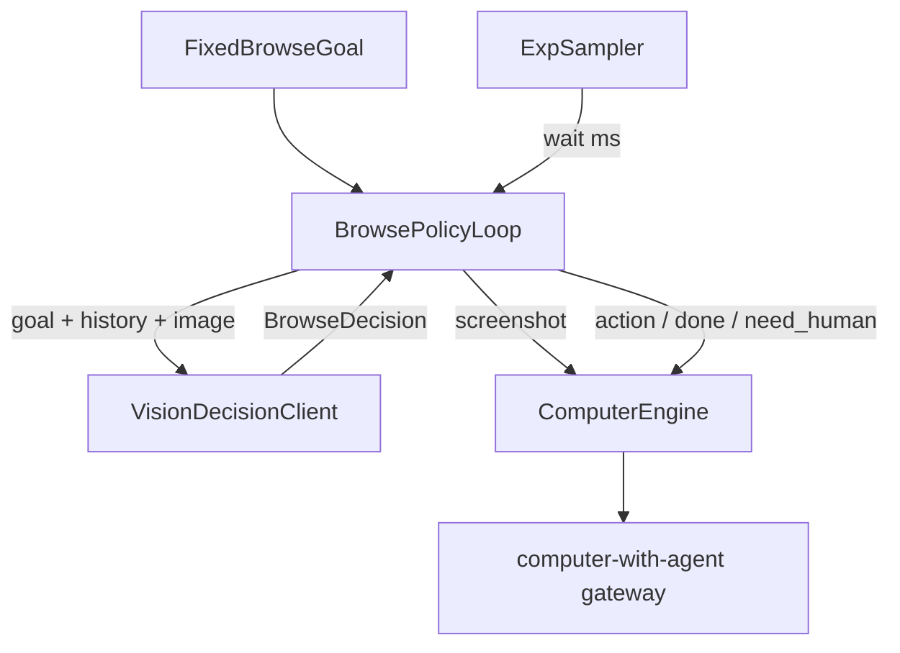

# Browse policy loop in relay-os

## Decisions (locked)

- **Repo:** [relay-os](/Users/richardemate/Projects/relay-os) only — no [computer-with-agent](/Users/richardemate/Projects/computer-with-agent) changes.
- **Home:** new package `@relay/browse-policy` (policy + timing + prompt loop). Desktop I/O stays in [`packages/engines-computer`](packages/engines-computer).
- **First dogfood:** standalone `browse_goal` ComputerTask that calls the loop (prove on a live gateway seat before Spec wiring).
- **Observation:** screenshot-first (vision). Prompt each turn from fixed goal + recent history + current PNG — not hand-written directional click scripts.
- **Timing:** inter-action waits ~ Exp(λ) with `[minMs, maxMs]` clamps; separate exit hazard μ (Bernoulli/geometric leave check after each step).

## Architecture

Reuse existing lease/screenshot/action surface in [`packages/engines-computer/src/computer-engine.ts`](packages/engines-computer/src/computer-engine.ts) and task runner in [`packages/engines-computer/src/tasks/runner.ts`](packages/engines-computer/src/tasks/runner.ts). Pattern reference (do not extend in place for computer): [`packages/llm-controller/src/index.ts`](packages/llm-controller/src/index.ts) observe→prompt→act loop with fixed 2s sleep.

## Phase 0 — Package contracts

Scaffold `packages/browse-policy` (`@relay/browse-policy`) matching monorepo package conventions (`tsc`, workspace deps).

Types:

- `BrowseGoal` — text goal, optional `startUrl`, optional `allowedActions`
- `BrowseObservation` — base64 PNG + timestamp + optional meta
- `BrowseDecision` — `wait` | `act` | `done` | `need_human` (+ gateway `ComputerActionPayload` when `act`)
- `BrowseTimingConfig` — `actionRateLambda`, `exitRateMu`, `minMs`, `maxMs`
- `BrowseLoopOptions` — max iterations, heartbeat TTL padding, evidence hooks

Pure `sampleExponentialWait(config)` + `shouldExit(mu)` with unit tests (clamps, approximate mean).

## Phase 1 — Core loop + dogfood task

Implement `runBrowsePolicyLoop({ goal, engine, decide, timing, ... })`:

1. Lease (or reuse) via `ComputerEngine`
2. If `startUrl`, navigate with existing helpers in [`packages/engines-computer/src/tasks/navigate.ts`](packages/engines-computer/src/tasks/navigate.ts)
3. Until stop: sample wait → sleep → heartbeat if needed → `screenshot` → build prompt from goal + last N steps → `decide(...)` → execute action or break on `done` / `need_human`
4. Release/park or recycle per options; return evidence summary (waits, decisions, screenshot refs)

`decide` is an injected client interface (vision-capable). Wire a thin adapter using the repo’s LLM stack ([`packages/engines-llm`](packages/engines-llm) / [`packages/llm`](packages/llm)) so the loop stays model-agnostic in tests.

Dogfood: register ComputerTask `browse_goal` (params: `goal`, `url?`, `lambda?`, `mu?`, `maxSteps?`) that constructs timing config and calls the loop. Export from engines-computer tasks index; keep builtins separate so apps opt in by registering the task.

## Phase 2 — Human-likeness + evidence

- Soft action-mix bias in the system prompt (click/scroll/type priors), not hard scripts
- Config switch for wait distribution: `exponential` (default) | `lognormal` (same clamp path)
- Structured run log suitable for later λ fitting against analytics

## Phase 3 — Spec / runtime hook

Add `BrowsePolicyController` implementing `AppController` (same interface as [`WorkflowController`](packages/workflow-runtime/src/controller.ts) / `LLMController`): stage goal from Spec/manifest → loop with `ComputerEngine` from the engines map → map `need_human` to existing feedback pause. Register only for stages that opt into autonomous computer browse; do not replace declarative `WorkflowController` for normal Specs.

## Tests

- Sampler: clamps, exit independence, mean sanity
- Prompt builder: always includes goal + latest observation; no static click itinerary
- Loop: mock `ComputerEngine` + mock `decide`; assert wait→observe→act ordering and stop on `done`
- Task: mock gateway HTTP like [`packages/engines-computer/test/computer-engine.test.ts`](packages/engines-computer/test/computer-engine.test.ts)

## Out of scope

- Gateway/API changes in computer-with-agent
- Fitting λ from production analytics (document later)
- a11y-tree observe (screenshot-only until gateway gains richer observe)
- Replacing `WorkflowController` for all Specs