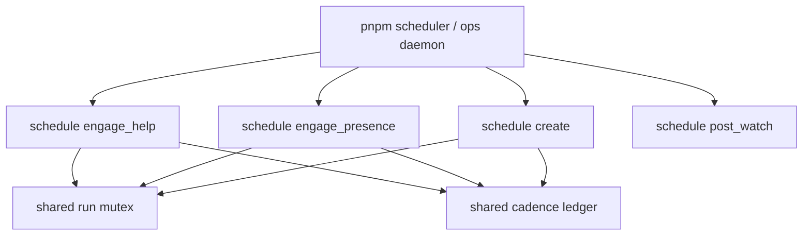
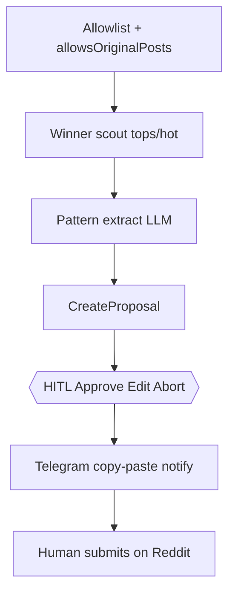
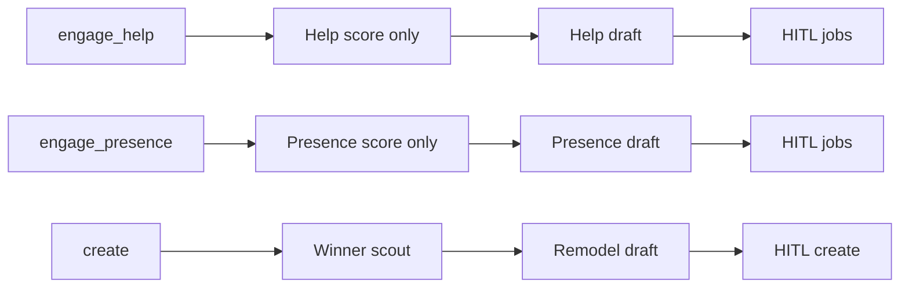

# CommunityEngager — Help / Presence / Create lanes

## Context

Legacy CE is optimized as a **help desk**: scout rewards advice language (`HELP_RE` / `wantsHelp` / `problemFit`), ICP is wardrobe systems, and **fit checks / hauls / WAYWT are downranked or skipped** (`HAUL_FLEX_RE`, `megathreadPolicy: skip`). Drafting is **reply-only** ([`draft_proposed_posts_f299b392.plan.md`](./draft_proposed_posts_f299b392.plan.md) explicitly excluded top-level posts).

That is good for soft GoStylens plugs and low ban risk. It is weak for Reddit **visibility** and **follower growth**, where sharp takes on fashion threads and occasional original posts win.

Authority rails already exist ([`community_engager_authority_metrics.plan.md`](./community_engager_authority_metrics.plan.md)): warmup, promo ratio, cadence, post-watch, visibility, VoltMem. This plan **adds lanes** on top of those rails — it does not replace HITL / dry-run / notify-only defaults.

**Related:** [`karma_per_contribution_2ca98e41.plan.md`](./karma_per_contribution_2ca98e41.plan.md) (karma/post by contribution — extend by `kind`), [`notify_only_redditapis_scout.plan.md`](./notify_only_redditapis_scout.plan.md).

## Goals

1. Keep **Help** as the default product-friendly lane.
2. Add **Presence** — engage fashion threads (fit checks, hot takes, tip-worthy posts) even when OP did not ask “what should I wear?”
3. Add **Create** — occasional original posts (own fit check, short guide, “what I learned”), **seeded by remodeled winners** from allowlisted tops/hot.
4. **Independent lane cadence** — each lane has its own entrypoint, ops intent, and schedule cron (pause/fire one without touching the others).
5. Ship conservative: intensity 0 on presence; create = **notify-only** submit in v1.

## Process model (locked)

**Separate schedules/ops per lane — not three OS daemons.**

| Want | Choice |
|------|--------|
| Independent when each lane runs | **Yes** — three manifest schedules + three one-shot ops intents |
| Independent scout / draft / budgets | **Yes** — each entrypoint is single-`kind` only (no mixed help+presence run) |
| Three `pnpm scheduler` / systemd units | **No (v1)** — keep one host (`pnpm scheduler`) that already owns `cadence` + `post_watch` |

Why not three processes: shared Reddit cookie jar, Telegram HITL present queue, run mutex, and day/week ledgers would race or double-notify. One host + per-lane entrypoints gives the operational separation you want without fighting yourself on the ThinkPad.



Escape hatch later: if one lane needs a different machine or credentials, split that entrypoint to its own unit — same code paths, different host. Do not start there.

## Non-goals (v1)

- Three separate OS daemons / systemd units for help vs presence vs create
- Auto-submit original posts via browser/oauth
- Follow/unfollow bots or mass follow campaigns
- Cross-posting the same create body to many subs
- Replacing help scoring for the help lane
- Scraping private/logged-in-only content beyond existing scout transports
- Mixed-lane engage runs (`presenceSharePerRun`)

## Design decision: remodel winners for Create

**Yes — prefer this over blank-slate “invent a post.”**

Winning posts already prove what the sub rewards (angle, length, structure, hook). Create should:

1. **Scout winners** on allowlisted, `allowsOriginalPosts` subs (top/week or hot, score + comment thresholds).
2. **Extract a pattern**, not copy text — e.g. “first-person fit check + one regret + one tip”; “3-bullet capsule mistake”; “before/after lesson.”
3. **Remodel** into an original title + body grounded in *our* voice / wardrobe / learnings (operator-supplied notes optional later).
4. **HITL** must see: source permalink(s), extracted pattern, proposed title/body, originality checklist.



**Guardrails (locked):**

| Rule | Why |
|------|-----|
| Never paste winner body/title verbatim | Ban / plagiarism / same-day mirror risk |
| Min age before remodel (e.g. ≥ 3 days) | Avoid riding today’s viral post |
| Cap sources per proposal (1–2) | Pattern clarity |
| Intensity 0 on create v1 (no product URL) | Trust first; plug only if playbook + operator edits |
| One create per sub per `createCooldownDays` | Spam avoidance |
| Store pattern + source ids in evidence | Audit + VoltMem learn |

## Three lanes

| Lane | `kind` | Target | Output | Cadence default |
|------|--------|--------|--------|-----------------|
| Help | `help` | Advice / systems asks | Comment reply | `maxHelpPerDay` (keep 5) |
| Presence | `presence` | Fashion visibility threads | Short take / tip / light joke | `maxPresencePerDay` (1–2) |
| Create | `create` | Sub allows originals | Title + selftext | `maxCreatePerWeek` (1–2) |

Presence burns **presence** budget (not promo). Create burns **create** budget. Promo ratio / intensity ≥1 stays help-lane only until explicitly opened later.



## 1. Taxonomy

Files: [`types.ts`](apps/community-engager/src/types.ts), [`map-drafts.ts`](apps/community-engager/src/reddit/scout/map-drafts.ts), run evidence, HITL [`feedback-map.ts`](apps/community-engager/src/decide/feedback-map.ts).

```ts
export type EngageKind = "help" | "presence" | "create";

// on CommunityDraft:
kind?: EngageKind; // default "help" for back-compat

export interface CreateProposal {
  id: string;
  kind: "create";
  subreddit: string;
  title: string;
  body: string;
  patternSummary: string;
  sourcePostIds: string[];      // t3_…
  source Permalinks: string[];
  status: ActionStatus;
  createdAt: string;
}
```

HITL card shows `kind` badge. Jobs fanout carries `kind` into draft/execute/notify.

## 2. Presence scoring

Today [`score.ts`](apps/community-engager/src/reddit/scout/score.ts) uses one 8-dim card and **zeros ICP/plug when `HAUL_FLEX_RE` matches**. That kills the exact threads presence wants.

**Approach:** classify candidate → run **help** or **presence** scorer (not one blended total).

Presence dimensions (equal weight, gate e.g. ≥4/6 or ≥5/7 — pick in impl + tests):

| Dim | Meaning |
|-----|---------|
| `fashionFit` | Fit check / outfit / style opinion / tippable fashion (incl. language today’s HAUL_FLEX catches) |
| `takeRoom` | Room for a short concrete take (photo+title, or opinion prompt) — not brand war / pure haul flex with nothing to say |
| `competition` | Low–moderate comments (reuse / tune `COMPETITION_MAX_COMMENTS`) |
| `freshnessOk` | Same maxAgeHours as scout (or slightly tighter) |
| `rulesOk` | Allowlisted + playbook allows presence |
| `voiceFit` | Not megathread unless playbook `megathreadPolicy` ∈ `{help_only, allow}` **and** presence enabled on playbook |

Playbook additions:

```ts
presenceEnabled?: boolean;       // default false → opt-in per sub
allowsOriginalPosts?: boolean;   // default false
createCooldownDays?: number;     // default 7
```

`megathreadPolicy` stays; presence on WAYWT only when playbook opts in (short comments, help_only intensity).

Help scorer: **unchanged** behavior for `kind: "help"`.

## 3. Presence draft

Extend [`draft-llm.ts`](apps/community-engager/src/stages/draft/draft-llm.ts) with `buildPresenceDraftPrompt`:

- 1–3 sentences; opinionated; optional light humor; one concrete tip
- **Intensity forced 0** while warmup active **or** until presence karma/reply threshold (config)
- No product, no links, no coach frameworks
- Respect photo/media constraints (existing `opMediaHint`)
- Eval cases in [`draft-cases.ts`](apps/community-engager/src/eval/draft-cases.ts) for fit-check + hot-take threads

## 4. Cadence budgets + per-lane schedules

Extend [`config/default.json`](apps/community-engager/config/default.json) `cadence`:

```json
"cadence": {
  "maxHelpPerDay": 5,
  "maxPresencePerDay": 2,
  "maxPromoPerDay": 1,
  "maxCreatePerWeek": 1,
  "maxJobsPerRunHelp": 2,
  "maxJobsPerRunPresence": 1,
  "maxJobsPerRunCreate": 1,
  "scheduleHelpCron": "0 9,13,18 * * *",
  "schedulePresenceCron": "0 11,16 * * *",
  "scheduleCreateCron": "0 10 * * 3",
  "scheduleHelpEnabled": true,
  "schedulePresenceEnabled": false,
  "scheduleCreateEnabled": false
}
```

Each scheduled fire invokes **one** entrypoint with that lane’s `maxJobsPerRun*`. Shared ledger still enforces day/week caps across manual one-offs + schedules.

Env mirrors for ThinkPad: `COMMUNITY_CADENCE_MAX_PRESENCE_PER_DAY`, schedule enable flags, etc. Playbooks default `presenceEnabled: false` / `allowsOriginalPosts: false` until operator promotes.

## 5. Create — winner remodel pipeline

New stage module e.g. `stages/create/` (or `reddit/create/`):

1. **Pick sub** — allowlist where `allowsOriginalPosts` and cooldown clear.
2. **Winner scout** — redditapis/json `top` (week) / `hot`; filters: min score, min comments, not megathread sticky, age ≥ `createMinSourceAgeDays` (default 3).
3. **Pattern extract** — LLM JSON: `{ patternSummary, angle, structureHints, avoidCopying }` from 1–2 winners (+ titles/bodies capped).
4. **Remodel draft** — LLM JSON: `{ title, body, rationale }` using pattern + voice rules + optional operator seed notes from config later.
5. **HITL** — Approve / Edit / Abort; card links sources.
6. **Execute** — v1: **manual notify only** (same as `COMMUNITY_POST_MODE=manual`); mark create ledger on “posted” via existing mark-posted / ops ack if available.
7. **Post-watch** — enroll create posts if we have a permalink after mark-posted (stretch; comments first is enough).

## 6. Entrypoints / ops

Extend [`manifest.ts`](apps/community-engager/src/manifest.ts) / `CommunityEntrypoint`:

| Entrypoint | Lane | Scout / pipeline |
|------------|------|------------------|
| `engage_help` (alias: `engage`) | help | Existing scout + help score/draft only |
| `engage_presence` | presence | Same listings transport; presence score/draft only |
| `create` | create | Winner remodel → HITL → notify |
| `post_watch` | — | Unchanged |

Manifest `schedules[]`: one row per lane (plus existing post_watch), each pointing at its entrypoint + cron from config. Presence/create schedules **default off**.

Ops one-shots (Telegram/CLI):

- `engage help` / `/engage_help` (bare `engage` → help)
- `engage presence` / `/engage_presence`
- `create propose` / `/create_propose`

Pause a lane = disable its schedule (or abort that entrypoint) without stopping the host or other lanes. Mutex: only one lane run (or post_watch) holds the ops run mutex at a time — overlapping crons queue and retry / skip with log.

## 7. Metrics + VoltMem

- Tag outcomes with `kind=help|presence|create`
- Post-watch / karma-per-contribution breakdown by kind ([karma plan](./karma_per_contribution_2ca98e41.plan.md))
- VoltMem: `got_upvotes` when score Δ positive; create learns from approved remodeled patterns
- Optional later: follower count snapshot (manual or rare profile fetch) on authority card — **not** required for P0

## Sequencing

| Phase | Ship | Notes |
|-------|------|-------|
| **P0** | Taxonomy + presence score/draft + `engage_presence` entrypoint/ops + budgets | Help stays default `engage`; presence schedule off |
| **P1** | Create remodel + `create` entrypoint/ops + weekly schedule (off) | Notify-only submit |
| **P2** | Metrics by kind + VoltMem tags + README/deploy knobs | Align with karma-per-contribution |

Rollout: playbooks opt-in (`presenceEnabled`, `allowsOriginalPosts`) on 1–2 trusted subs; flip `schedulePresenceEnabled` after manual `/engage_presence` looks good; create schedule last.

## Tests

- Presence: fit-check titles actionable under presence scorer; still non-actionable under help scorer
- Help regression: advice threads still ≥5/8
- Megathread: skipped unless playbook allows
- Presence draft: intensity 0; no product strings
- Create: verbatim title/body of source rejected by validator; cooldown respected; HITL payload includes sources
- Cadence: presence does not consume promo slots
- Entrypoint isolation: `engage_help` never enqueues `kind=presence`; `engage_presence` never enqueues help
- Overlapping schedule fire: second lane waits on mutex or skips with explicit log (no double HITL storm)

## Success criteria

- `/engage_help`, `/engage_presence`, and `/create_propose` each run a single lane with its own cadence knobs
- One scheduler host; presence/create schedules can be enabled independently
- Help lane quality / promo safety unchanged
- At least one create proposal/week can be generated from remodeled winners with clear source→pattern→original chain in HITL
- Authority/metrics can attribute karma and replies by `kind`
