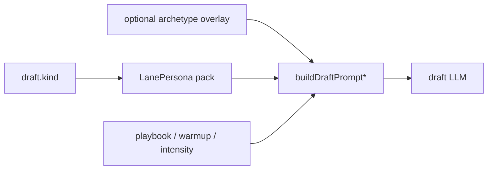

# CommunityEngager — lane personas (advice voice)

## Context

Lanes already exist ([`ce_help_presence_create_lanes.plan.md`](./ce_help_presence_create_lanes.plan.md)): **help** / **presence** / **create**, separate entrypoints, shared ops host.

Draft voice today is **lane rules + anti-AI bans**, not a named persona:

| Surface | Today | Gap |
|---------|--------|-----|
| Help | One “thoughtful fashion Redditor” block in [`draft-llm.ts`](../../apps/community-engager/src/stages/draft/draft-llm.ts) | Same voice for capsule, fit, work dress, systems asks |
| Presence | Short compliment / scroll-by; intensity 0 | Already anti-coach; heavy persona can hurt |
| Create | Remodel prompt (first-person, no plugs) in [`remodel.ts`](../../apps/community-engager/src/stages/create/remodel.ts) | Writer POV thin; not reply advice |
| Playbook | Promo/rules only ([`playbook.ts`](../../apps/community-engager/src/policy/playbook.ts)) | Compliance ≠ personality |
| Scout | `HELP_RE` / `ICP_RE` / wantsHelp ([`score.ts`](../../apps/community-engager/src/reddit/scout/score.ts)) | Archetype signals unused by drafter |
| Eval | threadFit / soundsHuman / specificity ([`draft-judge.ts`](../../apps/community-engager/src/eval/draft-judge.ts)) | No persona / voice-consistency dim |

Advice quality is mostly a **help-lane** problem: replies can be concrete and still feel interchangeable.

## Goals

1. **Help-first:** richer, consistent commenter stance that improves advice specificity and human rhythm.
2. **Lane-aware packs:** one persona shape, three packs — help deep; presence light; create = post writer POV.
3. **Style over fiction:** no invented biography, shops, or “when I wore X…” unless facts are explicitly authorized.
4. **Do not fight rails:** warmup, intensity, soft-CTA, playbook plug ceilings, presence intensity 0 stay authoritative.
5. **Measurable:** offline judge + HITL rubric can tell “same-y coach” from “this voice.”

## Non-goals (v1)

- Per-subreddit full character sheets (optional later; playbook stays rules/promo).
- Multi-account / multi-persona rotation or A/B in production.
- Replacing anti-AI ban lists (personas **compose with** them).
- Theatrical presence “influencer” voice.
- Changing scout ranking formulas (only optional archetype → prompt overlay).

## Locked design choices

| Decision | Choice |
|----------|--------|
| What “persona” means | Stance + judgment + sentence rhythm + hard bans — **not** a chatty character card |
| Biography | **Forbidden** unless `authorizedFacts[]` (curated, short, reusable) |
| Where it lives | New module e.g. `policy/persona.ts` (or `stages/draft/persona.ts`); prompts import packs |
| Playbook | Unchanged role (compliance); no personality fields in v1 |
| System role | Keep single user-message prompt shape unless provider needs a split later |
| Rollout | Ship help pack + wire first; presence/create packs in same PR only if thin |



## Persona shape (proposed)

```ts
type LanePersona = {
  id: string;                 // e.g. "help.default"
  lane: "help" | "presence" | "create";
  /** One-line who they are as a commenter (not a life story). */
  stance: string;
  /** How they decide / disagree (prioritize fit over brand, etc.). */
  judgment: string[];
  /** Rhythm: length, openings, when to ask a clarifying Q. */
  rhythm: string[];
  /** Extra bans beyond global anti-AI list. */
  bans: string[];
  /** Optional curated facts allowed in replies; empty = invent nothing personal. */
  authorizedFacts?: string[];
};
```

**Help default (direction, not final copy):** practical wardrobe peer — concrete, a little opinionated, prefers one strong suggestion over frameworks, will say “need rise/budget” instead of guessing, never sounds like a stylist funnel.

**Presence default:** warm glance — one noticed detail; never coaches; humor rare and kind.

**Create default:** first-person remodeled OP — specific, non-promo, sounds like a real poster not a brand.

Optional **archetype overlay** (help only): map scout-ish signals (e.g. ICP/systems vs thin “what should I wear”) to 2–3 extra prompt lines. Start with heuristics already available on the draft/thread text; do not require schema changes to scout scores in v1.

## Implementation outline

1. **`LanePersona` + default packs** — unit-test serialization / required fields.
2. **`buildDraftPrompt` / `buildPresenceDraftPrompt` / remodel** — inject stance/judgment/rhythm/bans; keep existing intensity + “do not invent personal story” (extend: “only use authorizedFacts if listed”).
3. **Config** — e.g. `persona.helpPackId` / env override; default on with current-equivalent stance if we need a kill switch.
4. **Eval** — add `personaFit` (1–5) or fold into soundsHuman with explicit judge instructions; 3–5 help fixtures that fail under generic coach voice.
5. **README** — one short section under Lanes; link this plan.

## Success criteria

- Help drafts vary by thread in **judgment** (what they prioritize), not just paraphrase of title.
- Blind HITL: fewer “sounds like every other AI stylist” aborts on help samples.
- Presence length/intensity regressions: still ≤280 chars vibe, intensity 0, no product.
- No increase in invented personal anecdotes (judge or spot-check).

## Risks

| Risk | Mitigation |
|------|------------|
| Persona fights soft-CTA / promo | Intensity + warmup sections stay after voice; product rules win |
| Model uses stance as license to invent backstory | Hard content rule + empty `authorizedFacts` by default |
| Presence becomes advice-y | Presence pack explicitly anti-coach; keep separate prompt |
| Prompt bloat | Cap packs to short bullets; don’t duplicate global ban list verbatim |

## Related

- [`ce_help_presence_create_lanes.plan.md`](./ce_help_presence_create_lanes.plan.md)
- [`ce_scout_rules.plan.md`](./ce_scout_rules.plan.md) — opportunity selection (complementary; do not merge)
- Draft LLM: [`apps/community-engager/src/stages/draft/draft-llm.ts`](../../apps/community-engager/src/stages/draft/draft-llm.ts)
- Drafter / stubs: [`apps/community-engager/src/stages/draft/drafter.ts`](../../apps/community-engager/src/stages/draft/drafter.ts)
- Playbook: [`apps/community-engager/src/policy/playbook.ts`](../../apps/community-engager/src/policy/playbook.ts)

## Open questions (resolve before/during implement)

1. **Authorized facts:** ~~ship empty in v1?~~ **Decided:** empty arrays on defaults; operators can add later via pack overrides.
2. **Archetype overlay:** ~~v1 or follow-up?~~ **Decided:** ship in help prompt via `classifyHelpThreadArchetype` (ICP → systems, thin body → thin_ask).
3. **Kill switch:** ~~config flag?~~ **Decided:** `draft.personaEnabled` / `COMMUNITY_PERSONA_ENABLED=false` → static Voice fallback.
