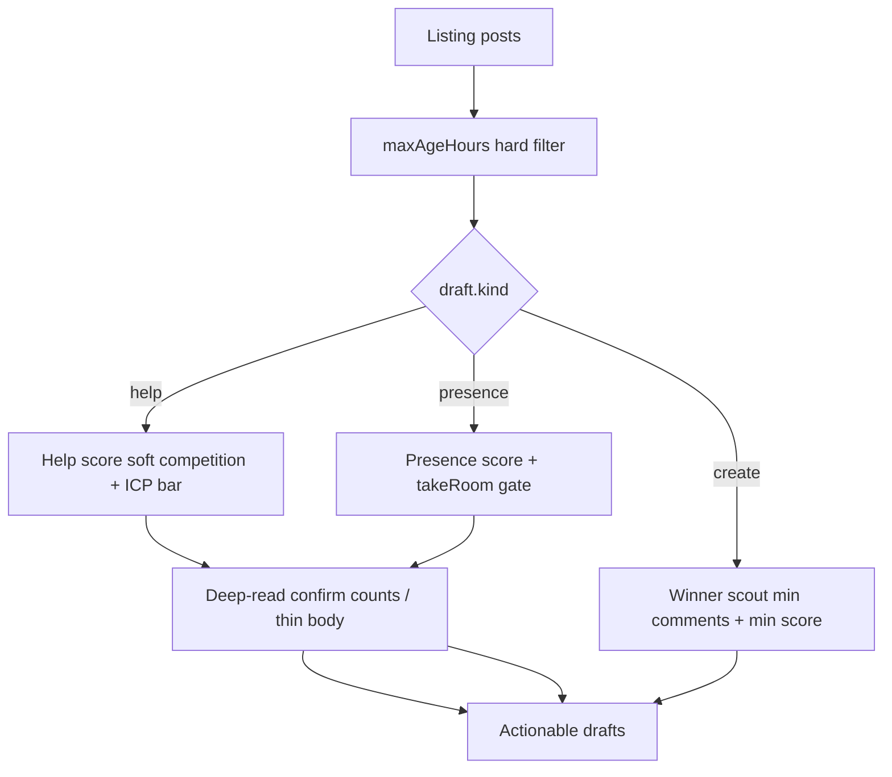

# CommunityEngager — scout rules upgrade

## Context

Lanes already use **different scorers** ([`ce_help_presence_create_lanes.plan.md`](./ce_help_presence_create_lanes.plan.md)):

| Lane | Scorer / path | Competition today |
|------|---------------|-------------------|
| Help | `scoreRedditPost` | `competition` true if `numComments ≤ 12` |
| Presence | `scorePresencePost` | true if `≤ 20` |
| Create | `scoutWinners` | **min** 8 comments (engagement proof), not a max |

Help/presence treat competition as a **boolean +1** toward actionable totals (5/8 help, 4/6 presence) — not a hard kill. Still, the model is “prefer quiet.” That misses threads where more comments signal **real engagement** and a strong reply can still surface (especially early-ish in a busy thread, or when OP’s ask is still unanswered well).

Related but separate: draft **voice** ([`ce_lane_personas.plan.md`](./ce_lane_personas.plan.md)). Better selection + better persona compound; do not merge plans.

**Key code:** [`score.ts`](../../apps/community-engager/src/reddit/scout/score.ts), [`map-drafts.ts`](../../apps/community-engager/src/reddit/scout/map-drafts.ts), [`types.ts`](../../apps/community-engager/src/types.ts), [`winner-scout.ts`](../../apps/community-engager/src/stages/create/winner-scout.ts), [`config.ts`](../../apps/community-engager/src/reddit/config.ts) (`scout.maxAgeHours`).

## Goals

1. Prefer **engaged-but-reachable** threads over empty ones.
2. Keep lane splits: help ≠ presence ≠ create filters.
3. Raise recall without dumping generic high-engagement noise into HITL.
4. Close known holes: age hard-drop, presence without takeRoom, create score unused, optimistic unknown comment counts.

## Non-goals (v1)

- Blending help + presence into one scorer.
- Auto-submitting create (still notify/HITL).
- Scraping private content or changing scout transports.
- Per-account karma-based caps (later).
- Rewriting draft prompts / personas (other plan).

## Locked design choices

| Decision | Choice |
|----------|--------|
| Competition model | Soft / sweet-spot, not “fewer comments always better” |
| Crowded help threads | Allowed when **ICP (or total bar) is strong** — not a global cap bump alone |
| Presence silence | **takeRoom required** for actionable |
| Create | Keep min engagement; **add** min score gate |
| Playbook | Optional comment sweet-spot overrides; presence/create enable flags stay ops config |

## 1. Competition → sweet spot

**Today:** `scoreCompetition(post, max)` → `numComments <= max` (unknown → true).

**Target:**

- Replace pure “low is good” with bands, e.g.:
  - Help: sweet ~3–25 (tunable); below floor = cold; above ceiling = crowded.
  - Presence: slightly higher ceiling (visibility threads often busier).
- Crowded (above ceiling):
  - Help: keep only if `icpFit` (or require `scoreTotal >= 6`).
  - Presence: keep only if `takeRoom` (and still fashionFit).
- Optional playbook fields later: `competitionSweetMax` / `competitionCrowdedMin` per sub — v1 can ship global constants + tests first.

Do **not** only raise `COMPETITION_MAX_COMMENTS` without the crowded bar — that reopens spammy “how do I dress” piles.

## 2. Freshness / age

- Scout hard-drops at `scout.maxAgeHours` (default **6**) before scoring — often a bigger miss than competition.
- Score dim still uses caller `maxAgeMs` (listing path aligns; legacy 48h only when omitted).
- **v1:** raise default and/or make lane-aware (help a bit longer than presence), document env override; avoid unbounded age.

## 3. Presence: require `takeRoom`

`isPresenceActionable` today: `rulesOk && voiceFit && total ≥ 4/6` — silent haul can still pass without takeRoom.

**Fix:** require `takeRoom === true` (or fold into actionable helper). Aligns with presence draft anti-coach intent.

## 4. Deep-read & unknown counts

- Unknown `numComments` → competition true is optimistic.
- On deep-read: set real count and re-score competition before enqueue when possible.
- Keep / strengthen `pickDeepReadCandidates` for thin body + help-shaped titles (shallow listing miss).

## 5. Create winner gate

`DEFAULT_MIN_SCORE = 50` in [`winner-scout.ts`](../../apps/community-engager/src/stages/create/winner-scout.ts) is **reserved unused**.

**Wire it** on listing `score` (upvotes) with existing `DEFAULT_MIN_COMMENTS` (8) + min age (3 days). Notify-only remodel — low ship risk.

## 6. Ops note (not code)

Many seeds keep `presenceEnabled` / `allowsOriginalPosts` false. Scoring upgrades won’t surface presence/create until playbooks allow — call out in README.

## Success criteria

- Help enqueue includes strong ICP threads in the mid/high comment band that previously lost only on competition.
- Crowded generic help asks still filtered (or rare).
- Presence: no silent flex without takeRoom.
- Create winners pass min score + comments + age.
- Tests cover sweet-spot, crowded+ICP, takeRoom gate, create min score.
- HITL volume does not explode (watch first week; tune ceilings).

## Risks

| Risk | Mitigation |
|------|------------|
| More crowded threads → buried replies | Prefer early-ish age window; crowded needs ICP/takeRoom |
| Raising maxAge → stale asks | Cap hours; freshness still a dim |
| Playbook complexity | Globals first; per-sub overrides optional follow-up |

## Related

- [`ce_help_presence_create_lanes.plan.md`](./ce_help_presence_create_lanes.plan.md) — lane taxonomy
- [`ce_lane_personas.plan.md`](./ce_lane_personas.plan.md) — draft voice (complementary)
- README scout / cadence tables in [`apps/community-engager/README.md`](../../apps/community-engager/README.md)

## Open questions

1. Exact help/presence sweet-spot numbers — **Decided:** help ≤25 / presence ≤35; cold ≤2 (rationale only); crowded help needs ICP or total ≥6.
2. Default `maxAgeHours`: 12 vs 24 for help?
3. Per-sub competition overrides in playbook v1 or follow-up?
