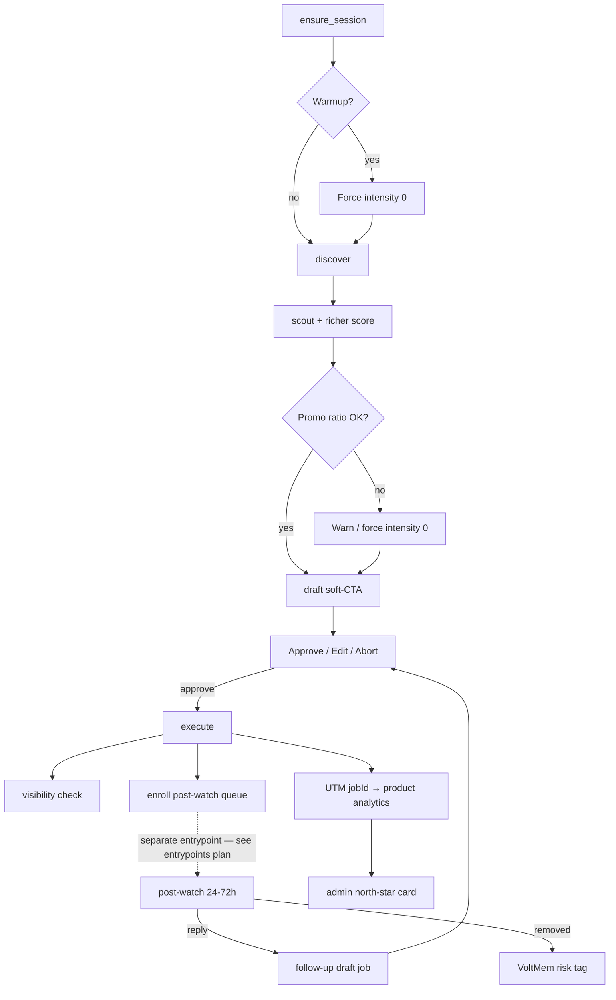

# CommunityEngager — authority building, workflow gaps, and metrics

Plan derived from the GoStylens Reddit dogfood review (2026-10-11). Builds on the existing HITL loop; does **not** replace hard gates (Approve before post, dry-run default, CAPTCHA never auto-solved).

**Related plans:**

- [`relay_hitl_community_voltmem.plan.md`](./relay_hitl_community_voltmem.plan.md) — core HITL + discover + fanout
- [`relay_reddit_browser.plan.md`](./relay_reddit_browser.plan.md) — browser scout / session / interstitial
- [`admin_shell_adapters_226b13a1.plan.md`](./admin_shell_adapters_226b13a1.plan.md) — admin-shell charts / collections
- [`relay_manifest_entrypoints_schedules.plan.md`](./relay_manifest_entrypoints_schedules.plan.md) — **entrypoint + cron-like schedules** (relocate post-watch off the engage pipeline; cadence consumes this)

**App:** [`apps/community-engager`](../../apps/community-engager)

**Sequencing note:** Finish this plan’s remaining domain todos (richer score → soft-CTA → …) before protocol entrypoints work, unless shared `maxJobs` / scout blocking makes the temporary `post_watch` parent stage painful — then do only slice **A0** of the entrypoints plan as a short interrupt. See that plan’s “Sequencing vs authority-metrics” section.

---

## Goal

Make the Reddit account act like a human who:

1. Discovers subreddits that match GoStylens target users
2. Finds threads where helpful advice builds authority over time
3. Drafts advice that may soft-mention / disclose GoStylens
4. Posts only after human approval
5. Proves the program is working with metrics beyond “jobs posted”

---

## What already works (baseline)

```
ensure_session → discover → scout allowlist → draft → Approve/Edit/Abort → execute → VoltMem learn
```

| Strength | Where |
|----------|--------|
| HITL Approve/Edit/Abort before any write | `controller.ts`, manifest |
| Dry-run default | `REDDIT_DRY_RUN` |
| Discover proposes; human promotes to postable | `discover.ts`, allowlist |
| Intensity 0–2 + intensity-2 second confirm | `draft-llm.ts`, `executor.ts` |
| Scout pacing / interstitial HITL | browser scout + interstitial decide |
| Ops funnel in admin | scouted → jobs → approved / aborted / failed / posted |
| UTM rewrite on existing gostylens.app links | `executor.ts` |

Hard rule remains: nothing posts without human Approve.

---

## Loopholes (gaps vs goal)

### 1. No account warmup / karma gate awareness

Pipeline goes straight to scout → draft. Many fashion subs silently filter by account age/karma. Admin funnel can look healthy while comments never surface.

### 2. No 9:1 enforcement in product

Intensity is per-draft, not per-account history. Several intensity-1/2 approvals in a week can look promo-heavy even if each draft felt soft.

### 3. Fire-and-forget after approve

No reply monitoring, no follow-up drafts, no soft-CTA → DM loop. Authority and signups usually come from the thread *after* the first comment.

### 4. Opportunity scoring is keyword-shallow

`scoreRedditPost` rewards help language + freshness + allowlist. Missing: comment competition, OP engagement likelihood, true ICP fit, whether a founder disclosure would feel natural.

### 5. Megathread skip may be over-strict

Daily Questions / WAYWT often hold real advice asks. Skipping them entirely may starve high-intent opportunities (needs a different playbook: short answers, rare plugs).

### 6. No shadowban / removal detection

`postedUrl` ≠ visible. Without a post-check, the system optimizes the wrong thing.

### 7. Attribution half-wired

UTMs rewrite existing links; `GOSTYLENS_LP_BASE_URL` is largely unused for injection. No closed loop into product analytics or “how did you hear about us?”

### 8. Persona risk

Browser pacing humanizes the *session*; voice can still read as the same LLM template across subs.

### 9. Discover fit ≠ ICP fit

Goal text is fashion/styling help-first, but there is no explicit GoStylens ICP filter (wardrobe systems, outfit planning, shopping paralysis vs haul/brand flex).

---

## Workflow improvements

| Priority | Change | Why |
|----------|--------|-----|
| P0 | **Warmup mode** — intensity forced to 0 for N days / until karma or help-comment thresholds; optional browse + upvote | Unlocks posting power without ban risk |
| P0 | **Promo-ratio ledger** — rolling window of intensity 0 vs 1–2; warn or block HITL past ~10% promo | Makes 9:1 enforceable |
| P1 | **Post-approval watch** — poll thread 24–72h; queue follow-up drafts | Turns one-shots into conversations |
| P1 | **Richer scout score** — `competition`, `icpFit`, `plugNaturalness` | Fewer “technically actionable” duds |
| P1 | **Soft-CTA drafts** — offer help before link; intensity 1 = mention, 2 = disclose + link | Matches how Reddit converts |
| P2 | **Subreddit playbooks** on allowlist — rules, plug style, megathread policy, max plugs/week | Promote becomes operational |
| P2 | **Cadence scheduler** — e.g. 3–5 help/day, ≤1 soft mention/week per sub | Looks like a person, not a batch |
| P2 | **Visibility check** after execute (logged-out permalink fetch) | Detect removal/shadowban early |
| P3 | **Close loop to GoStylens** — unique UTM per job + Reddit survey option | Prove users, not just comments |

Default setup stays; these are additive gates and stages.



> **Note:** `p1-post-watch` shipped domain logic + a temporary `post_watch` stage on the engage parent. Long-term placement is a separate `post_watch` entrypoint/schedule in [`relay_manifest_entrypoints_schedules.plan.md`](./relay_manifest_entrypoints_schedules.plan.md).

---

## Metrics ladder

Do **not** optimize karma alone.

### Leading (Reddit / agent health)

- Help vs promo ratio (rolling 30d)
- Comment visibility rate (posted and still public after 24h)
- Thread reply rate (OP or others reply)
- Upvote / downvote ratio on comments
- Sub coverage: % of high-ICP threads answered within 48h
- Account risk: blocks, removals, interstitial rate

### Conversion (business)

- Reddit → site sessions (`utm_source=reddit&utm_medium=community`)
- Signups / activations attributed to those UTMs
- Soft-CTA → inbound DM / profile visit (manual or tracked)
- Self-reported “Reddit” in onboarding

### North-star

**Qualified Reddit-attributed activations per week**, with constraints:

- promo ratio ≤ ~10%
- removal rate below a set threshold
- help comments remain the majority

Admin today surfaces the **ops funnel** (are we running). This plan adds **outcome metrics** (are we winning).

---

## How to surface metrics

### 1. Extend run/job evidence (smallest step)

Persist per job: `intensity`, `permalink`, `visibilityOk`, `replyCount`, optional `scoreDelta`. Aggregate in `runs-collection` series: `promoRatio`, `replyRate`, `visibilityRate` beside existing funnel charts.

**Touch:** `run-evidence.ts`, `job-queue.ts`, `admin/runs-collection.ts`

### 2. Allowlist dashboard strip

Per sub: posts, approve/abort rates (partially exist), plus **plugs/week** and **avg reply rate**. Rank by reply rate × ICP, not just approve count.

**Touch:** `allowlist-store.ts`, `admin/allowlist-collection.ts`

### 3. Product analytics join

Set `utm_campaign` = `jobId` (or `runId+sub`). In GoStylens analytics, a “Reddit community” insight: sessions → signup by campaign. Surface summary in admin-shell as external tile or nightly JSON import.

**Touch:** `executor.ts`, GoStylens product analytics, optional admin tile

### 4. Weekly authority score card

Weighted blend: `visibility × replyRate × (1 − promoRatio) × attributedSignups`. One glance number; drill into the ladder when it drops.

**Touch:** admin-shell viz / `runs-collection` series

### 5. VoltMem outcome tags

Beyond approve/abort/intensity, tag: `got_reply`, `removed`, `dm_interest`, `signup_attributed` so the drafter learns what worked.

**Touch:** `memory.ts`, `voltmem-domains.json`

---

## Practical default playbook (ops, not code)

For the first 30–90 days:

- Mostly intensity 0
- Rare intensity 1
- Almost never intensity 2
- Treat megathreads carefully (short help; rare plugs)
- Judge on reply quality + attributed activations, not weekly karma
- Expect early weeks to look flat; do not kill the program on vanity dashboards

---

## Implementation slices (recommended order)

### Slice A — enforce being a good citizen (P0)

1. ~~Warmup mode~~ **done** — intensity 0 clamp + thresholds + `{dataDir}/warmup/state.json`; browse+upvote cadence still deferred (`COMMUNITY_WARMUP_BROWSE` reserved)  
2. ~~**App config file** (`p0-app-config`)~~ **done** — `config/default.json` + optional `config/local.json`; secrets/paths/`REDDIT_DRY_RUN` stay in `.env`; env still overrides when set; `RedditEnvConfig` → `CommunityRuntimeConfig` / `getCommunityConfig`  
3. ~~**Nest `CommunityRuntimeConfig`** (`p0-nest-runtime-config`)~~ **done** — `reddit` / `warmup` / `discover` / `scout` / `jobs` / `product`; `RedditSessionConfig` for OAuth/cookies; `cfg.warmup.mode` not `cfg.warmupMode`  
4. ~~Promo-ratio ledger~~ **done** — `promo` in `config/default.json`; ledger at `{dataDir}/promo/ledger.json`; `onExceed` block|warn; HITL surfaces ratio; execute refuses promo when blocked  
5. Persist intensity + permalink on every job outcome  

### Slice B — learn after post (P1)

1. Visibility check after live execute  
2. ~~Post-watch domain (enroll + poll + follow-up drafts)~~ **done** — temporary parent stage; **relocate** via [`relay_manifest_entrypoints_schedules.plan.md`](./relay_manifest_entrypoints_schedules.plan.md) A0  
3. Soft-CTA bias in `draft-llm.ts` + LP URL injection when intensity ≥ 1  

### Slice C — score for ICP + prove users (P1–P2)

1. Extend `OpportunityScore` / `scoreRedditPost`  
2. UTM per `jobId`  
3. Wire attributed signup count into admin (even if manually pasted JSON at first)  

### Slice D — north-star surface (P3)

1. Authority score card + series in admin-shell  
2. VoltMem outcome tags feeding draft memory  
3. Sub playbooks + cadence caps on allowlist  

---

## Out of scope (for now)

- Multi-platform (Twitter/X, Discord) — still `CommunityPlatform = "reddit"`
- Auto-solving CAPTCHAs or bypassing interstitials
- Vote manipulation / multi-account schemes
- Auto-post without human Approve
- Replacing VoltMem or admin-shell with a third-party marketing suite

---

## Success criteria

| Criterion | Signal |
|-----------|--------|
| Safe growth | Promo ratio stays ≤ ~10%; removals rare; no shadowban surprises |
| Authority | Reply rate and visibility trend up on allowlisted subs |
| Product | Non-zero Reddit-attributed activations with UTM or survey evidence |
| Learning | Abort/approve + reply/removal tags change future draft intensity usefully |
| Ops | Admin shows north-star + ladder, not only scout→post funnel |
