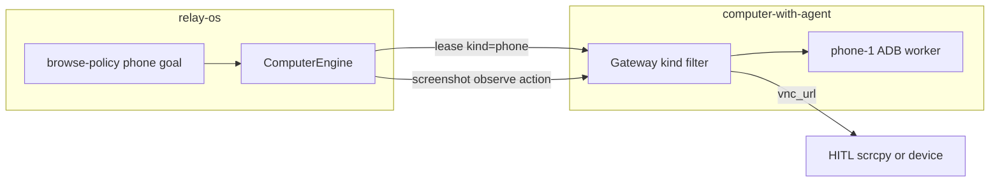

# Bind Relay to computer-with-agent phone seats

## Context (already shipped upstream)

[computer-with-agent](file:///Users/richardemate/Projects/computer-with-agent) now supports:

- Inventory seats with `kind: "desktop" | "phone"`
- `POST /v1/sessions` with `{ "kind": "phone" }`
- Phone actions: `tap`/`click`, `swipe`, `long_press`, `launch`, Android `key` (`back`/`home`/`recents`), optional `ref`
- `GET /v1/sessions/{id}/observe` — screenshot + trimmed UIAutomator `elements[]`
- Park soft force-stop / recycle `pm clear` on the phone worker
- HITL via lease `vnc_url` (scrcpy-web when configured; physical device OK for dogfood)

*(Historical.)* At plan start: engines leased desktop-only; browse-policy was Firefox-only. **Now:** engines support `kind=phone`; LLM phone goals live in [`@relay/phone-policy`](packages/phone-policy); browse-policy is desktop-only again ([`phone_policy_split.plan.md`](./phone_policy_split.plan.md)).

## Repo decision (locked)

**Work in relay-os only** for this plan. Do not change computer-with-agent unless a contract bug is found.

| Package | Role |
|---------|------|
| `@relay/engines-computer` | Typed gateway client — lease kind, actions, observe |
| `@relay/browse-policy` | *(Superseded for phone)* desktop Firefox only — see `@relay/phone-policy` |
| `@relay/phone-policy` | Phone goal loop / prompts / dogfood (after [`phone_policy_split.plan.md`](./phone_policy_split.plan.md)) |
| Apps | Optional dogfood only — **CommunityEngager stays desktop evidence-only** |

CommunityEngager stays **desktop evidence-only** unless a later explicit phone transport is designed.

## Architecture



## Phase 1 — `@relay/engines-computer`

### Lease

- Add `kind?: "desktop" | "phone"` to `ComputerLeaseParams` (default omit / `"desktop"` — zero change for existing callers).
- Include `kind` in `POST /v1/sessions` JSON body.
- Extend `ComputerLeaseInfo` with optional `kind`, `seat_id` from gateway response.
- Store on engine: `getKind()`, keep `getVncUrl()` for HITL (same field for noVNC or scrcpy-web).

### Actions

Widen `ComputerActionPayload`:

| Field | Use |
|-------|-----|
| `x1,y1,x2,y2`, `duration_ms` | swipe / long_press |
| `package`, `uri` | launch |
| `ref` | tap/long_press by observe ref |

Gateway already forwards these; engine only needs types + pass-through (already posts `params.action` as JSON).

### Observe

- New execute type `"observe"` → `GET /v1/sessions/{id}/observe?max_elements=…`
- Result data: `{ image, elements, geometry?, element_count }`
- Desktop workers return 404 — engine should surface a clear error (or document phone-only).

### Tests

- Mock fetch: lease body includes `kind: "phone"` when requested.
- Action payload with swipe/ref forwarded unchanged.
- Observe maps to GET `/observe`.

## Phase 2 — `@relay/browse-policy`

### Phone browse goal

- Extend `BrowseGoal` / task options with `seatKind?: "desktop" | "phone"` (default desktop).
- When phone: pass `kind: "phone"` on lease; **skip** `navigateToUrl` / Firefox address-bar helpers (use `launch` / `uri` or start from current screen).
- Prompt: phone system chrome (`home`/`back`/`recents`), swipe-heavy priors, no `ctrl+l` chords.
- `BrowseActionMixPriors`: add `swipe`, `long_press`, `launch` (soft weights in prompt).

### Observation mode

- Option `observeMode?: "screenshot" | "observe"` (phone default `"observe"` once stable; desktop stays screenshot).
- When observe: feed image + compact element list (ref/text/desc/clickable) into the decide prompt; allow model to emit `ref` taps.

### Timing

- Reuse existing Exp/lognormal waits; optionally slightly higher swipe settle ms for phone animations (config, not magic).

## Phase 3 — Dogfood (watchable)

Small runnable entry (prefer package script or `engines-computer` example over a new app):

```text
COMPUTER_GATEWAY_URL=http://localhost:9000
COMPUTER_API_TOKEN=…
# Gateway inventory must include a free phone seat
```

1. Lease `kind=phone`
2. Print `Watch: {vnc_url}` (and/or “watch the physical device”)
3. Run a short goal e.g. “Open Settings and open About phone” via browse-policy phone task **or** a fixed 5-step script if LLM not configured
4. Soft-park (not recycle) by default

Prereq on machine: A55 reachable via ADB to whatever hosts `phone-1` (local uvicorn :8000 or Compose profile `phone`).

## Desk / deploy follow-ons (relay-os owned)

Tracked here so computer-with-agent HITL can stay Watch-only:

| Item | Notes |
|------|--------|
| Desk take-over UI | Intervene via gateway `POST …/action` on `need_human`; do not rely on scrcpy-web input (upstream Watch is read-only). |
| `cu-phone.hsv` Caddy on ThinkPad | Document in `apps/relay-desk/LAPTOP.md` (or deploy Caddyfile): Host → `127.0.0.1:6083`. Upstream ships hsv inventory example + AGENTS snippet only. |

## Non-goals

- Changing computer-with-agent gateway/worker contracts
- iOS / Appium / Phone Harness cloud adapter (upstream phase 3)
- Wiring CommunityEngager or Reddit flows to phone
- Auto CAPTCHA / 2FA
- Requiring scrcpy-web before dogfood (physical screen is enough)
- Implementing Desk take-over or live ThinkPad Caddy in the computer-with-agent scrcpy Compose PR

## Dogfood checklist

- [ ] `ComputerEngine` lease `{ kind: "phone" }` returns phone `seat_id` / `vnc_url`
- [ ] Desktop lease callers unchanged (no kind → desktop)
- [ ] Swipe + home key + launch Settings succeed through engine
- [ ] `observe` returns elements; tap by `ref` works
- [x] Phone goal skips Firefox navigate; prints HITL URL *(via `@relay/phone-policy` / engines dogfood)*
- [ ] Soft park leaves app data; recycle still available explicitly

## Follow-ups

- **Desk phone claim/watch:** [`desk_phone_seats.plan.md`](./desk_phone_seats.plan.md) (HITL URL / claim only — unchanged by policy split)
- **Policy split (done):** [`phone_policy_split.plan.md`](./phone_policy_split.plan.md) — `@relay/computer-seat-policy` + `@relay/phone-policy`; browse-policy thinned
- **scrcpy-web on :6083:** computer-with-agent `.cursor/plans/phone_scrcpy_web_hitl.plan.md` (upstream; not CE)

## Open choices (resolve in first PR)

1. **Default phone observation:** observe-from-day-one (**chosen** under `@relay/phone-policy`).
2. **Dogfood home:** fixed-step in `packages/engines-computer/scripts/…`; LLM Telegram experiment in `@relay/phone-policy dogfood:phone-browse`. Desk claim/watch: [`desk_phone_seats.plan.md`](./desk_phone_seats.plan.md).
3. **navigate on phone:** `launch` package and/or uri via phone-policy helpers (`launchPackage` / `openUri`).

## Implementation order

1. Engine types + lease `kind` + tests
2. Observe + payload fields + tests
3. ~~browse-policy phone prompt/task~~ → moved to `@relay/phone-policy` (policy split)
4. Dogfood script + README notes