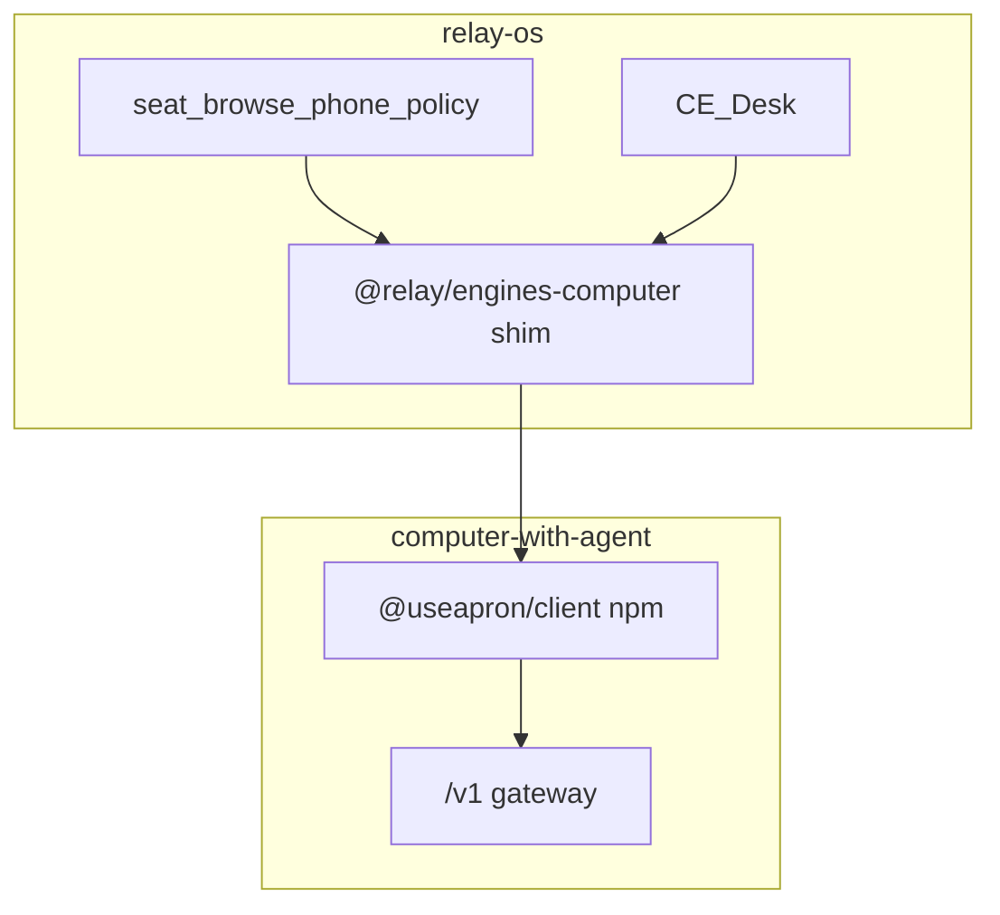

# Consume `@useapron/client`

**Canonical plan:** [computer-with-agent `ts_client_sdk.plan.md`](../../../computer-with-agent/.cursor/plans/ts_client_sdk.plan.md) — package home, protocol cut, publish.

This plan is **relay-os migration only**. Do not re-specify the public API here; link and follow the runtime repo.

`@useapron/client` is **already published**. Relay consumes it from **npm** — no sibling `file:` / path / link deps.

## Locked approach

| Decision | Choice |
|----------|--------|
| **Owner of client** | `computer-with-agent` (`packages/client` → `@useapron/client`) |
| **relay-os role** | Consumer of the published npm package |
| **Transition** | npm dep → shim `@relay/engines-computer` → delete shim |
| **Protocol** | If Desk/CE still need `ExecutionEngine`, wrap in a **local** adapter — do not push `@relay/*` back into the client |



## Consumers to update

| Package / app | Today |
|---------------|--------|
| `@relay/computer-seat-policy` | `workspace:*` → engines-computer |
| `@relay/browse-policy` | same |
| `@relay/phone-policy` | same |
| `apps/community-engager` | engines-computer bind |
| Desk / docs | README + LAPTOP pointers |

Dogfood scripts under `engines-computer/scripts` either move to examples in the client repo or stay as thin wrappers importing the npm package.

## Phased delivery

### 1 — Add npm dep

```json
"@useapron/client": "^<published-version>"
```

Run typecheck + existing computer tests against the registry package.

### 2 — Shim ✅

`packages/engines-computer` is now:

- re-export of public `@useapron/client` symbols
- `toExecutionEngine` / `toEngineResult` for `@relay/protocol` bind sites

Policy packs keep importing `@relay/engines-computer` until `switch-deps`.

**CJS note:** relay packages emit CommonJS. `@useapron/client@0.1.2` ships `exports.require` / `default` so Node can `require()` the ESM client. Dep is `^0.1.2`; the temporary pnpm patch is removed.

### 3 — Direct deps + remove source

- Point seat-policy / browse / phone / CE at `@useapron/client` (semver)
- Delete engine implementation from relay-os; keep shim one release if desired
- Then remove shim (`remove-shim`)

## Out of scope

- Re-implementing HTTP in relay-os
- Sibling `file:` / `link:` / path deps on `computer-with-agent/packages/client`
- Publishing seat-policy / browse / phone as npm (later plans)
- Changing CE evidence-only desktop semantics

## Success bar

- No duplicate gateway HTTP client in relay-os
- `pnpm` install resolves `@useapron/client` from npm; CE + policy dogfood still works
- Client package still has zero `@relay/*` deps

## References

- Canonical: [ts_client_sdk](../../../computer-with-agent/.cursor/plans/ts_client_sdk.plan.md)
- Related: [phone_policy_split](phone_policy_split.plan.md), [seat_policy_ce_desk_wire](seat_policy_ce_desk_wire.plan.md), [computer_phone_seat_bind](computer_phone_seat_bind.plan.md)
