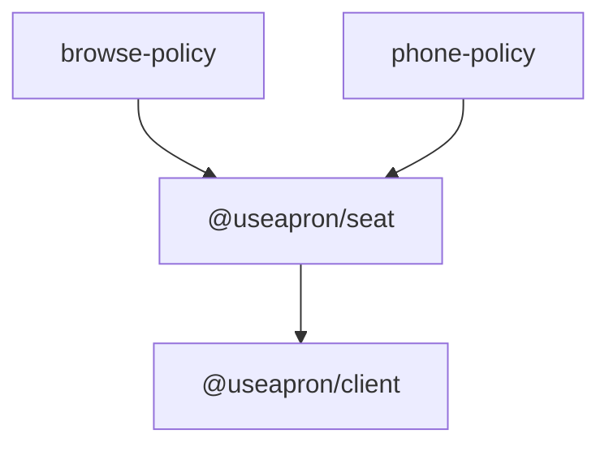

# Consume `@useapron/seat` ✅

**Canonical plan:** [apron `seat_loop_sdk.plan.md`](../../../apron/.cursor/plans/seat_loop_sdk.plan.md).

## Outcome

| Decision | Choice |
|----------|--------|
| **Owner of loop** | `apron` → npm `@useapron/seat` |
| **Depends on** | `@useapron/client` |
| **Prompts / LLM** | `@relay/browse-policy` / `@relay/phone-policy` |
| **Shim** | `@relay/computer-seat-policy` **deleted** |

## References

- Related: [consume computer client](consume_computer_client.plan.md), [phone_policy_split](phone_policy_split.plan.md)
