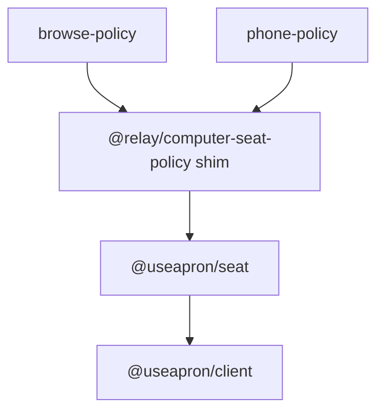

# Consume `@useapron/seat`

**Canonical plan:** [computer-with-agent `seat_loop_sdk.plan.md`](../../../computer-with-agent/.cursor/plans/seat_loop_sdk.plan.md).

This plan is **relay-os migration only**.

## Locked approach

| Decision | Choice |
|----------|--------|
| **Owner of loop** | `computer-with-agent` → `@useapron/seat` |
| **Depends on** | `@useapron/client` (already via seat or engines shim) |
| **Prompts / LLM** | Stay in `@relay/browse-policy` / `@relay/phone-policy` |
| **Transition** | npm dep → shim `@relay/computer-seat-policy` → remove shim |

## Phased delivery

1. Add `@useapron/seat` (and ensure `@useapron/client` is resolvable)
2. Shim or replace `packages/computer-seat-policy`
3. Update READMEs; keep CE evidence-only desktop semantics unchanged

## Out of scope

- Publishing browse/phone prompts as npm in this pass
- Changing gateway `/v1`

## References

- Canonical: [seat_loop_sdk](../../../computer-with-agent/.cursor/plans/seat_loop_sdk.plan.md)
- Related: [consume computer client](consume_computer_client.plan.md), [phone_policy_split](phone_policy_split.plan.md)
