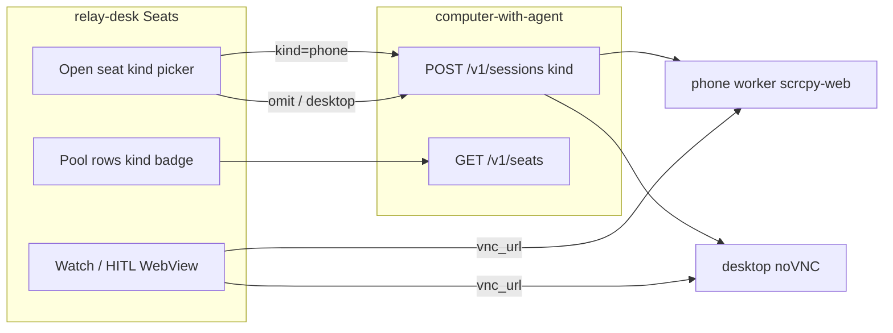

# Relay Desk — phone seat claim / watch

## Context

Sibling to [`computer_phone_seat_bind.plan.md`](./computer_phone_seat_bind.plan.md) (engines phone bind — done) and [`phone_policy_split.plan.md`](./phone_policy_split.plan.md) (LLM phone goals in `@relay/phone-policy`, browse-policy desktop-only). This plan is **Desk HITL only** — claim/watch/inventory; not CE or policy packs.

Gateway already returns `kind` + `seat_id` on lease and `GET /v1/seats`, and `/ready` exposes `free_desktop` / `free_phone`. Desk today:

| Surface | Behavior |
|---------|----------|
| [`leaseSession`](apps/relay-desk/src/gateway/client.ts) | `POST /v1/sessions` **without** `kind` → always desktop |
| [`GatewaySeat`](apps/relay-desk/src/gateway/types.ts) | No `kind` / `seat_id` fields |
| Pool rows in [`app.tsx`](apps/relay-desk/src/app.tsx) | `id · state` only |
| [`withVncViewerParams`](apps/relay-desk/src/gateway/vnc-url.ts) | Always adds noVNC `autoconnect` + `resize=scale` |
| Copy | “Firefox warm” on park |

Watch / HITL auto-open already open whatever `vnc_url` is present — so **agent-leased phone HITL can already stream** if the URL is reachable. What’s missing is **operator claim of a phone seat** and **kind-aware inventory**.

## Repo decision (locked)

- **Work in `apps/relay-desk` only** (plus tiny type docs if needed).
- Do **not** change computer-with-agent unless a Desk contract bug is found.
- Do **not** wire CommunityEngager or Spec “Computer” binding to phone in this plan (CE remains desktop evidence-only; agent automation uses `@relay/phone-policy` / engines dogfood separately).
- Default claim remains **desktop** so existing muscle memory is unchanged.

## Architecture



## Phase 1 — Types + lease API

### Types ([`gateway/types.ts`](apps/relay-desk/src/gateway/types.ts))

- `SeatKind = "desktop" | "phone"`
- `ComputerLease`: optional `kind`, `seat_id`
- `GatewaySeat`: optional `kind` (gateway already sends it as `kind` on each row)
- `SeatState`: optional `kind`, `seatId` so the console subtitle can show `phone-1` vs desktop

### Client ([`gateway/client.ts`](apps/relay-desk/src/gateway/client.ts))

```ts
leaseSession(settings, opts?: { kind?: SeatKind })
```

- Include `kind` in JSON body only when set (omit = gateway desktop default).
- Map response `kind` / `seat_id` through.
- `listGatewaySeats`: keep passthrough; typed `kind` on rows.

Optional: extend probe/`/ready` parsing later to show `free_phone` in the Gateway tile meta (nice-to-have in Phase 2).

## Phase 2 — Viewer URL safety

[`withVncViewerParams`](apps/relay-desk/src/gateway/vnc-url.ts):

- **Desktop / noVNC** (`pathname` contains `vnc.html` or host path looks like classic noVNC): keep injecting `autoconnect=1` + `resize=scale` when missing.
- **Otherwise** (e.g. `http://localhost:6083/`, `https://cu-phone.hsv/`): return URL unchanged.

Unit-test both URL shapes. Call sites (`openSeatWindow`, lease/watch) stay the same.

## Phase 3 — Claim picker + pool UI

### Open seat

- Replace single **Open seat** with a small kind control:
  - Default: **Desktop**
  - Alternate: **Phone**
- Prefer a compact segmented control or two CTAs (`Open desktop` / `Open phone`) — keep the Seats bento uncluttered (one job: claim).
- On phone claim failure (no free phone workers), surface gateway error text as today.

### Pool inventory

- Row label: `{id} · {kind} · {state}` (kind optional if older gateway omits it → treat as desktop).
- Optional muted counts in Gateway meta: `free N · phone M` when `/ready` or seats list allows.
- Copy: “Firefox warm” → “Worker warm · no claim” (kind-agnostic).

### SeatState after lease / acquire / watch

- Persist `kind` / `seatId` from lease or from the pool row being watched so the header can show `phone · phone-1` vs session id alone.

## Phase 4 — Dogfood checklist

Prereq: gateway inventory includes a free phone seat; scrcpy-web (or physical device) reachable at that seat’s `vnc_url`.

- [ ] Open desktop still leases without `kind` (or `kind=desktop`) and opens noVNC
- [ ] Open phone posts `{ kind: "phone" }`, shows `seat_id`, opens phone HITL URL
- [ ] Pool row for phone shows `kind=phone`; Watch / Acquire / Recycle work
- [ ] Parked phone → Acquire restores stream; Recycle frees seat
- [ ] HITL pending with phone `vnc_url` still auto-Watch
- [ ] noVNC URLs still get autoconnect/resize; scrcpy-web URLs do not get forced noVNC params

## Non-goals

- Browse-policy / LLM phone goals inside Desk
- Spec schematic “Computer” binding → phone
- CommunityEngager phone transport
- Multi-claim (one exclusive lease at a time remains)
- Embedding RFB/scrcpy in-page (separate WebView/browser tab stays)

## Implementation order

1. Types + `leaseSession({ kind })` + SeatState plumbing  
2. `withVncViewerParams` safety + tests  
3. Open-seat kind picker + pool kind badge + copy  
4. Manual dogfood against local gateway with phone inventory  

## Open choices (resolve in PR)

1. **Picker UX:** segmented Desktop|Phone vs two buttons vs Settings default kind.  
2. **Ready counts:** parse `/ready` `free_phone` in probe now vs seats-list-only.  
3. **Filter:** show free seats in pool (today only occupied) — out of scope unless needed to discover idle phone ids.
