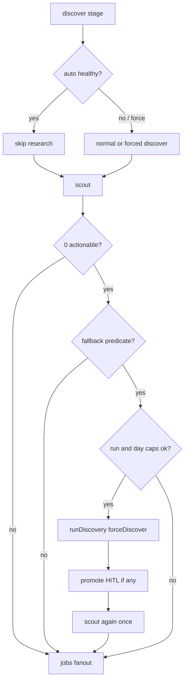

# Discover empty-scout fallback + engage-discover intent

## Goals

1. **Unattended:** if discover was skipped (`auto:healthy`) and scout finds **0** actionable opportunities **for the right reasons**, optionally run **forced discover** (+ promote HITL if needed) and **re-scout**, within hard caps.
2. **Operator:** Telegram/CLI intent for engage one-off with **`forceDiscover`** from the start (`engage discover` / `/engage_discover`).
3. **Safety:** no endless loops; no useless discover when emptiness is already-seen or hard-fail; HITL must stay attributable; default knobs **off**.
4. **Non-goal:** standalone `discover` entrypoint / discover-only process.



## Loopholes addressed

| Loophole | Plan response |
|----------|----------------|
| Empty only because already-seen | **Do not fallback** if excluded-seen dominates (see predicate) |
| HITL mid-scout stage confusion | Fallback runs **inside** `runScout` completion (same async HITL pattern as scout interstitial / discover stage); dedicated helper; tests with mock present |
| Long hang / CAPTCHA holding mutex | **Do not fallback** if scout left an unresolved challenge or hard session failure |
| Skip-all promotes on fallback discover | Still **consume** run+day attempt; log `fallback: no new postable`; second scout may still be empty — stop |
| Prefer newly promoted on scout #2 | Reuse `ctx.lastPromotedSubreddit` / `pickScoutSubs` prefer path (same as normal discover→scout) |
| Global `COMMUNITY_DISCOVER=force` | Predicate requires healthy skip → fallback is no-op (redundant, harmless) |
| Cadence fires reset run counter | Add **`onEmptyScoutMaxPerDay`** so unattended day cannot force-discover every tick |
| Ship feature, forget env | Docs/rollout checklist: flip `COMMUNITY_DISCOVER_ON_EMPTY_SCOUT=force` on ThinkPad |

**Accepted residual:** if discover **already researched** this run and scout is still empty, we do **not** force a second discover (avoids double research). Operator uses `/engage_discover` or wait for next day / allowlist edits.

## 1. Config knobs

Files: [`config/default.json`](apps/community-engager/config/default.json), [`app-config.ts`](apps/community-engager/src/app-config.ts), [`reddit/config.ts`](apps/community-engager/src/reddit/config.ts), [`community.env.example`](deploy/community.env.example).

```json
"discover": {
  "onEmptyScout": "off",
  "onEmptyScoutMax": 1,
  "onEmptyScoutMaxPerDay": 3
}
```

| Key | Values | Default |
|-----|--------|---------|
| `onEmptyScout` | `off` \| `force` | `off` |
| `onEmptyScoutMax` | positive int | `1` (per engage **run**) |
| `onEmptyScoutMaxPerDay` | positive int | `3` (calendar day in local host TZ, or UTC — pick one and document) |

Env: `COMMUNITY_DISCOVER_ON_EMPTY_SCOUT`, `COMMUNITY_DISCOVER_ON_EMPTY_SCOUT_MAX`, `COMMUNITY_DISCOVER_ON_EMPTY_SCOUT_MAX_PER_DAY`.

**Daily ledger:** small JSON under `{REDDIT_DATA_DIR}/discover/empty-scout-fallback.json` (date → count). Increment when a fallback **starts** (not only when it finds candidates). `/engage_discover` does **not** consume this ledger (manual intent is uncapped by the day budget; still subject to run mutex).

## 2. Fallback predicate

New helper (e.g. `stages/discover/empty-scout-fallback.ts`):

`shouldTriggerEmptyScoutFallback({ cfg, ctx, scoutResult, excludedSeen })` → `{ ok: boolean; reason: string }`

**Require all of:**

1. `cfg.discover.onEmptyScout === "force"`
2. `cfg.discover.mode !== "off"`
3. Actionable opportunities length `=== 0`
4. `ctx.discoverRan === false` and `ctx.discoverSkipReason` starts with `auto:healthy`
5. `(ctx.discoverEmptyScoutAttempts ?? 0) < onEmptyScoutMax`
6. Daily count for today `< onEmptyScoutMaxPerDay`
7. **Not** unresolved scout challenge on context / result
8. **Not** “already-seen only” emptiness:
   - If `excludedSeen > 0` and scout report shows **no** sub with status `empty` or `ok` with `opportunities === 0` from a real fetch (all blocked/timedOut/or zero subs planned) → **skip** with reason `already_seen_or_hard_fail`
   - Practical v1 rule: fallback only if `report.subs` has ≥1 entry with status `empty` or (`ok` and opportunities 0), **or** planned subs length > 0 and blocked/timedOut did not cover **all** planned subs leaving zero fetches — prefer the simple rule:

**v1 already-seen rule (implement exactly):**

- Let `fetchedEmpty = count of sub reports with status === "empty"` (scouted, zero opportunities).
- Let `hardFailAll = plannedSubs > 0 && every sub is blocked or timedOut`.
- Fallback **only if** `fetchedEmpty >= 1` and not `hardFailAll` and no `result.challenge`.
- If `excludedSeen > 0` and `fetchedEmpty === 0` → **no** fallback (`empty_due_to_exclusions`).

Stash `ctx.discoverSkipReason` in `runDiscover` whenever the gate skips.

## 3. Controller fallback (same engage run)

File: [`controller.ts`](apps/community-engager/src/controller.ts).

After first scout applies results (still inside scout `onStageStart` / `runScout`, **before** returning — so FeedbackBroker HITL works like existing discover + scout interstitial flows):

```text
applyScoutResult(...)
if shouldTrigger... 
  await runEmptyScoutDiscoverFallback(ctx)
```

**`runEmptyScoutDiscoverFallback`:**

1. Increment `ctx.discoverEmptyScoutAttempts`; bump daily ledger; log attempt N/max and day count
2. Call existing discover pipeline with `forceDiscover: true` (same challenge / choice / promote handling as `runDiscover` — extract shared apply if needed so HITL is not duplicated incorrectly)
3. On promote, set `ctx.lastPromotedSubreddit` exactly as today’s discover feedback path
4. If no new postable after discover (skip-all / no candidates): log `fallback: no new postable`; still proceed to one re-scout
5. `runScout` again with prefer = `lastPromotedSubreddit` when set
6. **Do not** call fallback again from the second scout (attempts already ≥ max when max is 1; also short-circuit if `ctx.discoverEmptyScoutFallbackDone`)

Mutex: entire engage run (including fallback HITL) holds the ops run mutex — document; no change to mutex API.

## 4. Ops intent: engage with discover

No new entrypoint. Extend one-off engage.

### Command shape

[`command.ts`](apps/community-engager/src/ops/command.ts):

```ts
| { kind: "one_off"; entrypoint: CommunityEntrypoint; forceDiscover?: boolean }
```

### Parse / slash

[`parse.ts`](apps/community-engager/src/ops/parse.ts) — longer phrases before bare `engage`:

- `engage discover` · `engage with discover` · `force discover engage`
- `/engage_discover` → `engage discover`

Update `OPS_HELP`, `OPS_TELEGRAM_COMMANDS` (`engage_discover`).

### Wire `forceDiscover` into the app

- `CommunityEngagerAppOptions.forceDiscover?: boolean`
- Before stages: `getContext().forceDiscover = true`
- `OpsCreateAppOptions` + `createApp` in ops controller, `run-scheduler.ts`, `run-ops.ts`
- Ack: `⏳ Starting one-off engage (force discover)…`
- Does **not** increment empty-scout daily ledger

## 5. Tests + docs

| Case | Expect |
|------|--------|
| Healthy skip + `fetchedEmpty >= 1` + force | discover once + second scout |
| `excludedSeen > 0` and `fetchedEmpty === 0` | no fallback |
| All subs blocked/timedOut | no fallback |
| Unresolved scout challenge | no fallback |
| `onEmptyScoutMax: 1` | no second fallback in same run |
| Daily cap exhausted | no fallback; log day cap |
| Skip-all promotes | attempt consumed; one re-scout; stop |
| Discover already ran | no fallback |
| `onEmptyScout: off` | no fallback |
| `/engage_discover` / `engage discover` | `forceDiscover: true` on createApp |
| Plain `engage` | no force flag |

Docs: README ops table; discover/cadence note; ThinkPad rollout “flip env”; mutex duration warning when fallback HITL waits.

## Out of scope

- Discover-only entrypoint or schedule
- Changing `scout.maxSubs` / `minPostable` defaults
- Fallback when discover already ran this tick (use `/engage_discover`)
- Raising per-run max above 1 in defaults

## Rollout

1. Ship with `onEmptyScout: off`
2. Deploy; verify `/engage_discover` manually
3. Flip `COMMUNITY_DISCOVER_ON_EMPTY_SCOUT=force` on ThinkPad
4. Watch logs for `empty-scout fallback` / `already_seen` / day-cap skips in the first days
