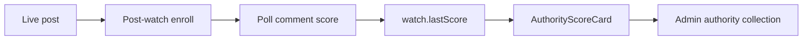

# Karma-per-contribution on authority scorecard

## Goal

Surface **karma per accepted contribution** (and a per-subreddit breakdown) so you can judge whether the engager is picking better threads over time — not just “jobs posted.”

## Definitions (locked)

- **Accepted contribution** = a post-watch row enrolled after a live post (already in [`post-watch.ts`](apps/community-engager/src/stages/post-watch/post-watch.ts)).
- **Karma proxy** = `lastScore` on that watch (Reddit comment `score`/`ups` from existing poll). Account `total_karma` stays warmup-only; we do **not** add a second account-karma scraper.
- **Scored contribution** = watch with a finite `lastScore` (unchecked watches excluded from the ratio until first successful fetch).
- **Removed** watches still count if they have a score (they earned/lost score before removal).
- **Window** = same rolling `windowDays` as the authority card (default 30), filtered by `enrolledAt`.



## Where it lives

Extend the existing north-star path — do not invent a new collection:

1. [`apps/community-engager/src/metrics/authority-metrics.ts`](apps/community-engager/src/metrics/authority-metrics.ts) — compute + format
2. [`apps/community-engager/src/admin/authority-collection.ts`](apps/community-engager/src/admin/authority-collection.ts) — list/get/series/viz
3. [`packages/admin-shell/src/types.ts`](packages/admin-shell/src/types.ts) — `AuthorityScorecardViz` fields
4. Tests in [`apps/community-engager/test/authority-metrics.test.ts`](apps/community-engager/test/authority-metrics.test.ts)
5. One-line note in [`apps/community-engager/README.md`](apps/community-engager/README.md) under authority metrics

## Scorecard fields to add

On `AuthorityScoreCard`:

- `karmaTotal` — sum of `lastScore` in window
- `scoredContributions` — count with finite `lastScore`
- `acceptedContributions` — all watches in window (enrolled)
- `karmaPerContribution` — `karmaTotal / scoredContributions` (0 if none scored)
- `bySubreddit: Array<{ subreddit, scored, karmaTotal, karmaPerContribution }>` — sorted by `karmaPerContribution` desc, then `scored` desc

`formatAuthorityLog` gains something like: `karma/post=0.37 (11/30)`.

Admin list row: add a **Karma/post** column. Viz `counts` / ladder get the new totals; series point includes the scalars (not the full by-sub array).

## Implementation sketch

In `evaluateAuthorityScore`, widen the watches input to include `status | enrolledAt | subreddit | lastScore`, apply the same window cutoff used for promo/visibility, then aggregate. `resolveAuthorityScoreCard` already loads watches — no new I/O.

Pure helper (same file or tiny export) for testability:

```ts
aggregateKarmaFromWatches(watches, { windowDays, nowMs })
```

## Out of scope

- Account-level karma delta / OAuth profile polling
- Changing scout ranking or auto-dropping low-karma subs
- Relay Desk UI (admin-shell authority view is enough for v1)

## Related context

Builds on completed work in [community_engager_authority_metrics.plan.md](.cursor/plans/community_engager_authority_metrics.plan.md) (post-watch already stores `lastScore`).
