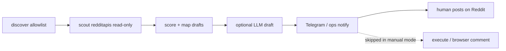

# Notify-only workflow + redditapis scout

## Context

Official Reddit Data API approval is stuck/silent. Browser-logged scout/comment triggered account “verify human / register as an app.” Product decision:

1. **Automate:** discover → scout → score → (optional) draft → **notify**
2. **Human:** open permalink and post manually in Reddit
3. **Scout transport:** [redditapis.com](https://www.redditapis.com/) **read-only** (Bearer API key only — [no Reddit session for public reads](https://docs.redditapis.com/docs/faq))

**Non-goals (this plan):** wire redditapis write/DM/login; replace official OAuth forever; Devvit; change discover/allowlist policy logic.

## Goals

1. **Safe default for deploy:** no Playwright comment / OAuth write on the hot path when `COMMUNITY_POST_MODE=manual`.
2. **Reliable public-sub scout** without logging into Reddit for reads.
3. **Actionable notifies:** permalink + score + suggested draft text so manual posting is fast.
4. **Reuse** existing score / `listingPostsToDrafts` / draft LLM / action-store where possible.
5. **Escape hatch:** `COMMUNITY_POST_MODE=auto` keeps today’s Approve → execute path for later.



## Design decisions

| Decision | Choice | Why |
|----------|--------|-----|
| Post mode | Explicit `manual` \| `auto` | Clearer than overloading `REDDIT_DRY_RUN` (dry-run still means “simulate execute”) |
| Default | `manual` in deploy docs; code default can stay `auto` for local fixtures until env flipped | Avoid surprising local HITL dogfood |
| redditapis writes | **Never** in this plan | Session cookies + ToS gray area; defeats the point |
| Draft stage | **Keep** in manual mode | Suggested reply is the value of notify-only |
| HITL Approve in manual | Approve = “accepted opportunity / mark ready”; **does not** call `executeApproved` | Or replace Approve with Done / Skip — see notify section |
| Scout in `auto` | Prefer `redditapis` when key present, else today’s browser → json → oauth → fixtures | Key present ⇒ avoid browser login for scout |
| Account for posting | Human’s normal Reddit account | Scout traffic not tied to that login |

## 1. Config: `COMMUNITY_POST_MODE`

**Files:** [`reddit/config.ts`](apps/community-engager/src/reddit/config.ts), [`app-config.ts`](apps/community-engager/src/app-config.ts) / [`config/default.json`](apps/community-engager/config/default.json), [`.env.example`](apps/community-engager/.env.example), [`deploy/community.env.example`](deploy/community.env.example).

```ts
export type PostMode = "manual" | "auto";
// env: COMMUNITY_POST_MODE=manual|auto
```

**Controller behavior** ([`controller.ts`](apps/community-engager/src/controller.ts)):

- After draft HITL in **manual**: update store (e.g. `approved_manual` / `notified`), send notify with permalink + draft, **return without** `runExecute`.
- **auto**: unchanged Approve → `executeApproved`.
- Belt-and-suspenders: if somehow execute runs in manual, `executeApproved` refuses with a clear error.

**Cadence / warmup / promo:**

- Manual mode: still score intensity for *suggested* draft; do **not** advance help-comment / promo ledgers on “approve” (only if we later add explicit “I posted” ack — optional stretch).
- Document that warmup counters won’t move until human ack or mode=auto posts.

## 2. redditapis read client

**New:** `apps/community-engager/src/reddit/redditapis/client.ts` (+ thin types).

- Auth: `Authorization: Bearer ${REDDITAPIS_API_KEY}` only.
- Endpoint: `GET /api/reddit/posts?subreddit=&sort=new&limit=` ([docs](https://docs.redditapis.com/docs/listings/posts)).
- Map response → existing [`RedditListingPost`](apps/community-engager/src/reddit/client.ts) (`text` → `selftext`, `comments` → `numComments`, permalink normalize).
- Config: `REDDITAPIS_API_KEY`, optional `REDDITAPIS_BASE_URL` (default `https://api.redditapis.com`).
- **No** login, cookies, proxy, comment, vote, or DM helpers in this package surface.
- Errors: log per-sub and continue (same pattern as [`scoutRedditLive`](apps/community-engager/src/reddit/scout/scout-live.ts)).
- Modest pacing (reuse cadence delays if any; avoid burst hammering — vendor + courtesy).

## 3. Scout source: `redditapis`

**Files:** [`scout.ts`](apps/community-engager/src/stages/scout/scout.ts), [`config.ts`](apps/community-engager/src/reddit/config.ts) (`ScoutSource` union + `parseScoutSource`).

**New:** `apps/community-engager/src/reddit/scout/scout-redditapis.ts` — mirror `scoutRedditLive`:

- allowlist / `subreddits` opts
- `listingPostsToDrafts` + playbook
- `excludeIds` / limit

**`scoutOpportunities` wiring:**

- Explicit `SCOUT_SOURCE=redditapis` → that path only (fail if key missing).
- `auto` chain when key configured: **redditapis → json → oauth → fixtures** (skip browser first when key present to avoid login walls). When key absent: keep current browser → json → oauth → fixtures.

**Discover empty-scout fallback:** unchanged; only scout transport changes.

## 4. Notify cards (manual mode)

**Payload (Telegram / adapter notify):**

- `r/{sub}` · score total · intensity hint
- Title (truncated)
- Permalink (full `https://www.reddit.com/...`)
- Suggested draft body (from draft stage)
- Short instructions: “Post manually on Reddit; reply Done when posted / Skip to dismiss” (if we add buttons)

**HITL options (pick one in implementation — prefer A):**

| Option | Behavior |
|--------|----------|
| **A (preferred)** | Keep Approve / Edit / Abort; Approve = accept draft for notify + store; **no execute** |
| B | New buttons: Open / Done / Skip; drop Approve→execute coupling |

Edit still rewrites suggested text before notify. Abort drops the opportunity.

**Idempotency:** same action-store ids; avoid re-notifying already `approved_manual` / `posted` / skipped.

## 5. Tests

- Mapper: redditapis post JSON → `RedditListingPost` → `listingPostsToDrafts` actionable fixture.
- Config: `parseScoutSource("redditapis")`, `PostMode` env parsing.
- Controller/unit: manual mode never calls `executeApproved` (mock).
- Client: mock `fetch` — Bearer header present; no session headers.

## 6. Docs & rollout

- README: notify-only diagram; “do not enable writes on redditapis.”
- `.env.example`:
  - `COMMUNITY_POST_MODE=manual`
  - `SCOUT_SOURCE=redditapis` (or `auto` + key)
  - `REDDITAPIS_API_KEY=`
  - Keep `REDDIT_DRY_RUN=true` anyway
- Deploy checklist (ThinkPad): set key + post mode; confirm Telegram card; confirm no headed browser for scout; human posts from personal account after verifying the inbox notice separately.

## Rollout order

1. `post-mode-config` + execute guard (shippable alone — immediate safety).
2. `redditapis-client` + `scout-source` + tests.
3. `notify-cards` polish.
4. Docs / deploy env flip.

## Risks & residuals

| Risk | Mitigation |
|------|------------|
| Vendor ToS / outage | Keep `json` + fixtures fallback in `auto`; document vendor risk |
| Cost at scale | Cap scout limit / cadence; monitor credits |
| Response shape drift | Golden fixture + mapper tests |
| Manual mode forgets to post | Notify includes permalink; optional later “Done” ack for metrics |
| Inbox “verify human” on posting account | Separate from scout; user verifies personal account; don’t browser-login that account for scout |

## Out of scope / later

- redditapis write path
- Official OAuth resurrection as primary scout
- Admin UI opportunity inbox (Telegram/ops sufficient for v1)
- Auto-open browser to permalink on Approve
