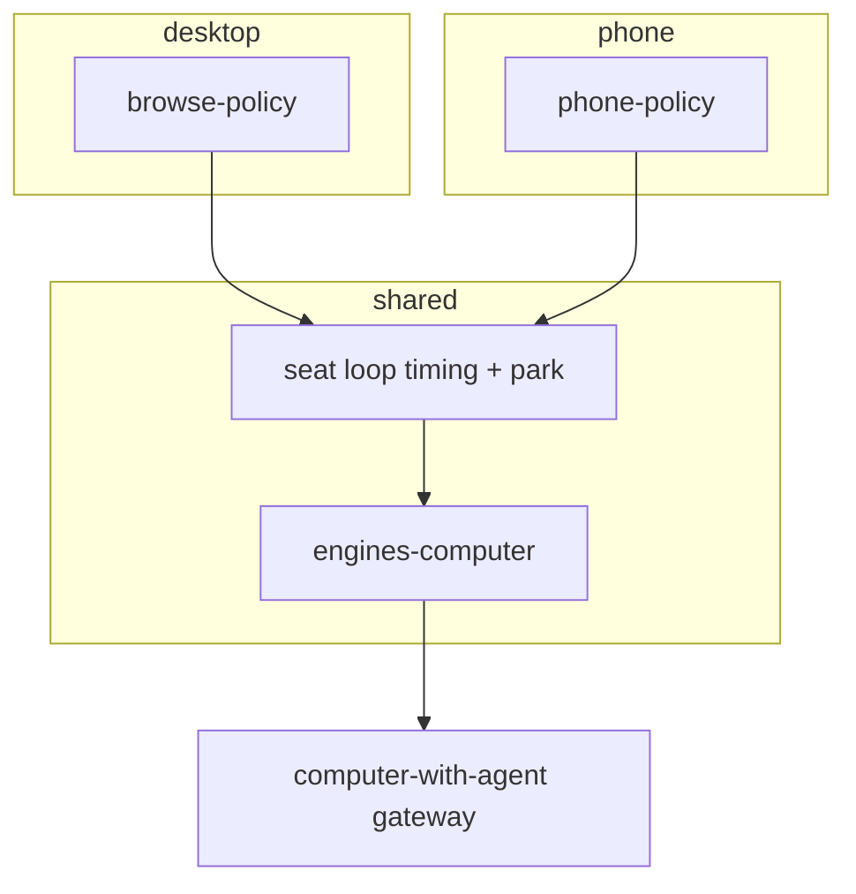

# Split phone automation out of browse-policy

## Why

[`computer_phone_seat_bind.plan.md`](./computer_phone_seat_bind.plan.md) shipped phone support by extending `@relay/browse-policy` with `seatKind: "phone"`. That got dogfood working, but the **product framing is wrong**:

| | Browse-policy | Phone automation |
|--|---------------|------------------|
| Surface | Desktop Firefox | Android apps |
| Navigate | Address bar / URL | `launch` package/uri |
| Observe | Screenshot | Screenshot + UIAutomator `observe` / `ref` |
| Motions | click, scroll, type, key chords | tap, swipe, long_press, home/back/recents |
| Example goal | “Find pricing page” | “Open Telegram → Amsterdam → ❤️” |

Reusing the **loop shape** (goal → human-like wait → observe → one micro-decision → act → park) is fine. Reusing **browse-policy as the phone package** forces `if (phone)` forks, confuses models (e.g. `kind: "action"` vs `"act"`), and blocks a clean Spec/Desk story later.

## Decision (locked)

1. `**@relay/engines-computer**` — stays the typed gateway client (already phone-capable). No split needed.
2. **Shared seat loop** — extract timing + observe/decide/act/park from browse-policy (new thin package or `packages/computer-seat-policy`).
3. `**@relay/browse-policy**` — desktop browser only again (or shim deprecated phone entry for one release).
4. `**@relay/phone-policy**` — phone prompts, defaults (`observe`, swipe settle, launch), dogfood / tasks.
5. **CommunityEngager** — remains desktop evidence-only (unchanged).

## Architecture

## Phase 1 — Extract shared loop

From today’s [`packages/browse-policy/src/loop.ts`](packages/browse-policy/src/loop.ts) / [`timing.ts`](packages/browse-policy/src/timing.ts) / decide plumbing:

- `runSeatPolicyLoop(engine, options)` with hooks:
  - `captureObservation` (screenshot vs observe)
  - `buildPrompts` / `decider`
  - `beforeLoop` (optional navigate or launch)
  - settle rules after certain action types
- Keep browse-policy calling this with desktop capture + Firefox navigate.

Prefer **one new package** over burying shared code inside browse-policy so phone-policy does not depend on “browse” naming.

## Phase 2 — `@relay/phone-policy`

- Types: `PhoneGoal`, `PhoneLoopOptions` (`observeMode` default `"observe"`)
- Prompts: Android chrome, swipe/long_press/launch/ref; **no** ctrl+l / pricing-page language
- Decider schema: same act/done/need_human, with aliases (`action`→`act`) and phone action fields first-class
- Helpers: `launchPackage`, optional “open uri”
- Task: `phone_goal` (mirror `browse_goal` but phone-native)
- Script: move [`phone-browse-dogfood.ts`](packages/browse-policy/scripts/phone-browse-dogfood.ts) here; default Telegram experiment goal stays optional `--goal`

## Phase 3 — Thin browse-policy

- Remove `seatKind: "phone"` path from loop/prompt/controller/task (or implement as thin re-export that logs deprecation once)
- Desktop tests stay green; phone tests move to phone-policy
- README: browse = desks; link phone-policy for Android

## Phase 4 — Docs & pointers

- Update engines-computer README dogfood section
- Link from `computer_phone_seat_bind` “follow-up: policy split”
- Desk phone seats plan unchanged (HITL URL only)
- Upstream scrcpy-web plan remains computer-with-agent

## Non-goals

- Rewriting computer-with-agent contracts
- Wiring CE / Reddit to phone
- Spec `computer.phone` verb (later; design once phone-policy is stable)
- Guaranteeing Telegram ❤️ reliability (experiment only)

## Migration / compatibility

| Caller | After |
|--------|--------|
| Spec `computer.browse` | Still browse-policy (desktop) |
| `browse_goal` + `seatKind: "phone"` | Deprecated → `phone_goal` / phone-policy dogfood |
| Fixed Settings dogfood | Stays `@relay/engines-computer dogfood:phone` |

## Implementation order

1. Extract shared loop + browse-policy uses it (behavior-preserving)
2. Add phone-policy + move dogfood + tests
3. Remove phone forks from browse-policy
4. Docs + deprecation note

## Open choices

1. **Package name:** `@relay/phone-policy` vs `@relay/mobile-policy` vs `@relay/computer-phone-policy`
2. **Shared home:** `@relay/computer-seat-policy` (**chosen** in extract-seat-loop)
3. **Shim duration:** hard remove phone from browse-policy in same PR vs one release deprecated re-export