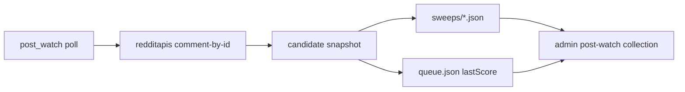

# Post-watch sweep metrics + admin UI

## Context

Hourly post-watch now succeeds via redditapis (`GET /api/reddit/comment/{id}`). A successful pending sweep looks like:

```json
{
  "outcome": "pending",
  "fetchOk": true,
  "httpStatus": 200,
  "replyCount": 0
}
```

That proves transport health but not **whether the comment is landing**. Reddit already returns `ups` / `score` on the comment node; we drop them. Operators also have no admin surface for the queue or sweep history (only Authority aggregates replyRate later).

## Goals

1. **Thin snapshot per checked candidate** when `fetchOk`: score, replyCount (already), removed/deleted flags, fetch source.
2. **Durable for charts**: sweeps stay the source of truth; optionally denormalize `lastScore` on the queue row for fast list.
3. **Admin**: browse live watches + open a watch to see score/outcome over time (and latest sweep context).
4. **Reuse** admin-shell collection patterns (Jobs / Authority); no Reddit session, no redditapis writes.

## Non-goals

- Full comment body / reply text in sweep JSON (follow-up drafts already carry reply context).
- Feeding Authority scorecard from sweep scores (Authority stays promo × visibility × replyRate × activations).
- Real-time push / Websocket; refresh via existing list/get.
- Changing poll cadence or first_look / sustained phases.

## Design decisions

| Decision | Choice | Why |
|----------|--------|-----|
| Metrics set | `score`, `replyCount`, `removed`, `deleted`, `fetchSource` | Enough to trend engagement; cheap; no PII dump |
| Score field | Prefer Reddit `score`, fallback `ups` | Same as Reddit UI karma on comments |
| Source of truth | Sweep candidate rows | Already one file per run; natural time series |
| Queue denorm | `lastScore`, `lastFetchSource` on `PostWatchEntry` | List without scanning every sweep |
| Admin shape | New collection `post-watch` | Don’t overload Authority or Actions |
| Detail UX | Custom `post-watch-watch` viz + raw JSON fallback | Sparkline / table of checks; unknown kinds already fall back |
| Sweep list | Optional `filter.view=sweeps` on same collection | One tab; ops can still open a raw sweep |



## 1. Fetch layer — capture score

**Files:** [`comment-fetch.ts`](apps/community-engager/src/reddit/write/comment-fetch.ts)

Extend `FetchedComment`:

```ts
score?: number; // Reddit score / ups at fetch time
```

In `mapCommentData`:

```ts
score: Number(d.score ?? d.ups ?? NaN)
// omit or leave undefined if not finite
```

`FetchCommentResult.source` already exists (`redditapis` | `public_json`) — persist it on the candidate as `fetchSource`.

**Tests:** map a fixture node with `ups: 3` → `score: 3`; redditapis path already covered in post-watch tests — assert `comment.score`.

## 2. Sweep + queue snapshot

**Files:** [`post-watch.ts`](apps/community-engager/src/stages/post-watch/post-watch.ts)

### `PostWatchSweepCandidate` (additive)

```ts
score?: number;
removed?: boolean;
deleted?: boolean;
fetchSource?: "redditapis" | "public_json";
// replyCount, httpStatus, fetchOk, outcome already present
```

Helper (keep DRY across pending / replied / removed / expired / error-with-partial):

```ts
function candidateSnapshot(fetched: FetchCommentResult): Partial<PostWatchSweepCandidate>
```

On every path where we have a `comment`, set snapshot fields. On transport error, leave score undefined; keep `fetchSource` if known.

Bump `schemaVersion` only if we need a hard break — prefer **additive fields** and keep `schemaVersion: 1` (admin ignores unknown keys today).

### `PostWatchEntry` (denorm)

```ts
lastScore?: number;
lastFetchSource?: "redditapis" | "public_json";
```

Update whenever a check returns `fetchOk` with a finite score (or clear on removed).

### Success criteria for “metrics present”

A pending success row should look like:

```json
{
  "outcome": "pending",
  "fetchOk": true,
  "httpStatus": 200,
  "replyCount": 0,
  "score": 2,
  "removed": false,
  "deleted": false,
  "fetchSource": "redditapis"
}
```

## 3. Admin collection

**New files:**

- [`apps/community-engager/src/admin/post-watch-collection.ts`](apps/community-engager/src/admin/post-watch-collection.ts)
- Source helper in [`sources.ts`](apps/community-engager/src/admin/sources.ts) — same root as authority (`REDDIT_DATA_DIR` / `authoritySource` path pattern): `postWatchSource()` → `{ driver: "file", path: dataDir }`

**Wire:** [`host/admin.ts`](apps/community-engager/src/host/admin.ts) — register `createPostWatchCollection(postWatchSource())`.

### Capabilities

| Cap | Behavior |
|-----|----------|
| `list` | Default: queue watches (newest `lastCheckedAt` / `enrolledAt` first). Columns: id, subreddit, status, phase hint, score, replies, lastChecked, preview (short URL or title) |
| `list` + `view=sweeps` | Recent sweep files (like Jobs) — columns: sweepId, startedAt, checked, replied, pending, errors, success |
| `get` | `watch-<id>` → queue entry + `history[]` rebuilt from sweeps that mention `watchId` (score, replyCount, outcome, phase, checkedAt≈sweep startedAt or lastChecked). `sweep-<id>` → raw sweep JSON |
| `series` | Points `{ t, score, replyCount }` for one watch id (query / body id) — feeds chart mode if we wire it; otherwise detail viz is enough for v1 |

**No actions** in v1 (mark_posted stays on Actions).

### History rebuild

Scan `post-watch/sweeps/*.json` newest-first, cap (e.g. 200 files), collect candidates matching `watchId`. O(n) is fine for local/ThinkPad ops volumes; if it grows, add an optional per-watch ledger later — **out of scope**.

## 4. Admin shell UI

**Files:** [`packages/admin-shell/src/types.ts`](packages/admin-shell/src/types.ts), [`packages/admin-shell/public/app.js`](packages/admin-shell/public/app.js)

1. Add detail kind `"post-watch-watch"` (string union + docs comment).
2. In `renderDetail`, when `detail.kind === "post-watch-watch"`:
   - Header: subreddit · status · postedUrl link
   - Small table or definition list: last score, replies, fetch source, expires
   - Timeline table: time · phase · outcome · score · replies · source
   - Optional tiny sparkline from `detail.viz.history` (score only) — nice-to-have; table alone is enough for v1
3. List columns work with existing generic table — no chart-mode toggle required unless series is hooked like Authority.

**Filter UX:** reuse existing status/limit filters; document `view=sweeps` in collection label subtitle or README (admin may not have a view toggle — if shell only has status, encode as `status=sweeps` **or** add a small view switch only if status filter is free). Prefer **`filter.status = "sweeps" | "watches"`** (default watches) to avoid shell changes.

## 5. Tests

| Area | Cases |
|------|--------|
| `mapCommentData` / fetch | score from ups; source redditapis |
| `processDuePostWatches` | pending candidate includes score + fetchSource; queue `lastScore` updated |
| `post-watch-collection` | list rows from temp queue; get watch returns history from two sweep fixtures |

## 6. Docs / rollout

- README post-watch paragraph: mention snapshot fields + Admin **Post-watch** tab.
- No `.env` changes (uses existing `REDDITAPIS_API_KEY` + data dir).
- After deploy: one `pnpm watch:posts` → open Admin → Post-watch → confirm score on the capsulewardrobe watch.

## Implementation order

1. **fetch-score** — map score on `FetchedComment`
2. **sweep-snapshot** — candidate + queue denorm + tests
3. **admin-collection** — list/get (+ optional series) + host wire
4. **admin-shell-ui** — `post-watch-watch` detail renderer
5. **tests-docs** — collection tests + README

## Open questions (resolve while implementing)

1. **Score on removed comments** — still record last known score before marking removed? **Proposal: yes** when body was fetched.
2. **Chart mode on home** — skip for v1; detail timeline is enough.
3. **Link from Actions → Post-watch** — optional later (`postedUrl` / draftId deep link).
