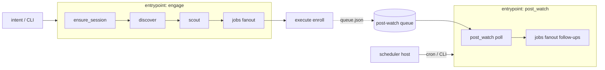

# Relay — manifest entrypoints and cron-like schedules

**Status:** **Complete (A0–A5)** — entrypoints, schedules, croner host, admin surface, cadence engage via `@relay/scheduler`. Spawned from the post-watch architecture discussion while executing [`community_engager_authority_metrics.plan.md`](./community_engager_authority_metrics.plan.md).

**Related plans:**

- `[community_engager_authority_metrics.plan.md](./community_engager_authority_metrics.plan.md)` — authority program; owns enroll + domain logic for post-watch; **relocates** pipeline placement here
- `[relay_hitl_community_voltmem.plan.md](./relay_hitl_community_voltmem.plan.md)` — core HITL + fanout runtime
- `[admin_shell_adapters_226b13a1.plan.md](./admin_shell_adapters_226b13a1.plan.md)` — admin discovery of schedules later

**Packages / app:** `@relay/protocol`, `@relay/runtime`, host (CLI / future scheduler), `[apps/community-engager](../../apps/community-engager)`

---

## Problem

Today a manifest is one linear `stages[]` plus intent `triggers`. Hosts call `app.run()` and walk every stage. That fits **engage** (session → discover → scout → jobs).

It does **not** fit **post-watch**:

- Work comes from a durable queue filled by past executes
- Due time is wall-clock (24–72h), not “after scout”
- Needs its own job budget so follow-ups do not starve scout opportunities
- Does not need browser session / discover / scout for public `.json` polls

Putting `post_watch` between scout and jobs was a valid vertical slice for domain logic; it is the wrong long-term *entrypoint*.

Same pattern will hit **cadence** (daily help caps) and any future backlog drain.

---

## Design principles

1. **Stages = steps in one run.** Schedules are not stages with delays.
2. **Entrypoints = named pipelines** the host can start independently.
3. **Host owns the clock.** Protocol declares *what* can be scheduled; OS/cron/Cloudflare/etc. decide *when*.
4. **Reuse AgentRuntime + fanout + HITL.** Do not invent a second workflow engine.
5. **Prove app-local first**, then lift into protocol when a second consumer appears (or admin needs discovery).




---

## Target shape (protocol sketch)

Additive only — existing manifests keep working (`stages` = default entrypoint).

```ts
interface AgenticAppManifest {
  // existing fields…
  stages: StageDefinition[];       // default entrypoint body
  triggers: IntentTrigger[];

  /** Named alternate pipelines (optional). */
  entrypoints?: Record<string, {
    description: string;
    stages: StageDefinition[];
    triggers?: IntentTrigger[];    // e.g. "watch posts"
  }>;

  /** Declarative schedules for hosts (optional). Host executes; runtime does not sleep. */
  schedules?: Array<{
    id: string;
    entrypoint: string;
    cron?: string;
    every_ms?: number;
    enabled?: boolean;
  }>;
}
```

**CommunityEngager mapping:**


| Entrypoint                  | Stages                                           | Start          |
| --------------------------- | ------------------------------------------------ | -------------- |
| `engage` (default `stages`) | ensure_session → discover → scout → jobs         | intent / CLI   |
| `post_watch`                | post_watch → jobs (from follow-up opportunities) | schedule / CLI |


Enroll remains inside job `execute` on the engage path. Policy knobs stay in `config/default.json` → `postWatch.*`.

**Out of protocol (host / dataDir):**

- Overlap lease (do not run engage + post_watch writers concurrently if needed)
- Missed-tick policy (skip vs catch-up)
- Secrets, `postWatch.enabled`

**Avoid:** `stage.when: { delay: "24h" }` — that forces a durable job queue inside AgentRuntime.

---

## Implementation slices

### Slice A0 — app-local carve-out (do first when this plan starts)

No protocol change yet.

1. Remove `post_watch` from `CommunityEngagerManifest.stages`
2. Add `CommunityPostWatchManifest` (or `entrypoints.post_watch` locally until protocol exists): `post_watch` → `jobs` fanout reusing `CommunityJobManifest`
3. CLI / trigger: `watch posts` / `--entrypoint post_watch`
4. Keep `enrollPostWatch` on live execute
5. Document: engage no longer drains watches; cron or manual second command does
6. Own budget: `postWatch.maxPerRun` + optional `jobs.maxJobs` override for this entrypoint

**Exit:** Follow-ups no longer share scout’s `COMMUNITY_MAX_JOBS` in the same run.

### Slice A1–A2 — protocol entrypoints + schedule declarations

1. Extend `@relay/protocol` types; keep backward compatible
2. Host / `AgentRuntime` accepts `entrypoint?: string` (default = root `stages`)
3. `schedules[]` is metadata for discovery; runtime does not interpret cron
4. Update `bindEngines` to walk all entrypoint stage trees
5. Tests: default path unchanged; named entrypoint runs only its stages

### Slice A3 — scheduler host

**Library: [croner](https://www.npmjs.com/package/croner)** (chosen).

Zero-dep, TypeScript-native, Node ≥18 (we require ≥22). Prefer over `node-cron` / `node-schedule` for timezone/DST, built-in overrun `protect`, `catch`, and `nextRun` / next-N (admin “next due” without a separate cron-parser). Skip BullMQ/Agenda — those are durable queues, not a thin clock.

1. Add `croner` as a dependency of the scheduler host package (or community-engager dogfood host until extracted)
2. Minimal runner: read `schedules[]` (manifest and/or `config`) → `new Cron(expr, { timezone, protect: true, catch: true }, …)` → invoke entrypoint
3. File lease under `{dataDir}/schedules/{id}.lock` even with `protect` (covers process restarts / double host)
4. Missed-tick policy v1: **skip** (do not catch up a backlog of fires)
5. Emit run evidence + last/next fire times (`job.nextRun()`) for admin later
6. Ship with CommunityEngager `post_watch` as the dogfood schedule (e.g. every 6h)
7. Escape hatch: OS cron / launchd calling CLI `--entrypoint post_watch` remains valid for A0 without croner

### Slice A4 — admin surface

List entrypoints + schedules; show last/next when evidence exists. Depends on A1–A3.

### Slice A5 — cadence handoff

`[community_engager_authority_metrics.plan.md](./community_engager_authority_metrics.plan.md)` `p2-cadence-scheduler` should **consume** this mechanism (scheduled engage with tighter caps, or a `cadence` entrypoint) — not invent a parallel cron in the app.

---

## Sequencing vs authority-metrics plan

**Recommendation: finish authority-metrics domain work first; start this plan when touching scheduling again (or immediately after soft-CTA if post_watch-in-pipeline bites).**


| Now (authority-metrics)                                                                  | Later (this plan)                                         |
| ---------------------------------------------------------------------------------------- | --------------------------------------------------------- |
| Richer scout score, soft-CTA, playbooks, visibility, UTM, admin north-star, VoltMem tags | Relocate post_watch; entrypoints; schedules; cadence host |
| Keep enroll + `post-watch.ts` domain logic                                               | Change *how* poll/follow-up is started                    |
| Leave temporary `post_watch` stage in engage parent                                      | A0 removes it                                             |


**Why not pause authority-metrics for protocol work?**

- Scoring / drafts / attribution unlock product learning without runtime redesign
- post_watch domain code is already reusable; only the wiring moves
- Protocol work is cross-cutting; better after one more dogfood signal (cadence) confirms the pattern

**Why not wait until the entire authority plan is done before A0?**

- If shared `maxJobs` / scout CAPTCHA blocking follow-ups hurts ops, do **A0 only** as a short interrupt, then return to authority P1s. Defer A1+ (protocol) until needed.

**Cadence (`p2-cadence-scheduler`):** mark as blocked on this plan’s A0–A3 (or implement cadence only as config gates inside engage until schedules exist).

---

## Success criteria


| Criterion   | Signal                                                                          |
| ----------- | ------------------------------------------------------------------------------- |
| Separation  | Engage parent stages do not include post_watch                                  |
| Budget      | Follow-up jobs use a dedicated budget / run                                     |
| Declarative | Manifest (or app docs) names `post_watch` entrypoint + optional schedule        |
| Compatible  | Existing `CommunityEngager` default run behavior unchanged except removed stage |
| Reuse       | Cadence and future drains use the same entrypoint/schedule mechanism            |


---

## Out of scope

- In-runtime `sleep(24h)` or delayed stages
- Distributed multi-machine scheduler (single-host dogfood first) — no Redis/`node-cron` distributed mode yet
- BullMQ / Agenda / Temporal as the schedule clock
- Auto-post without HITL on follow-ups
- Replacing intent triggers — schedules are additive

