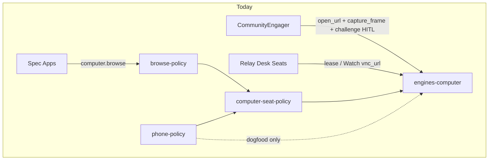
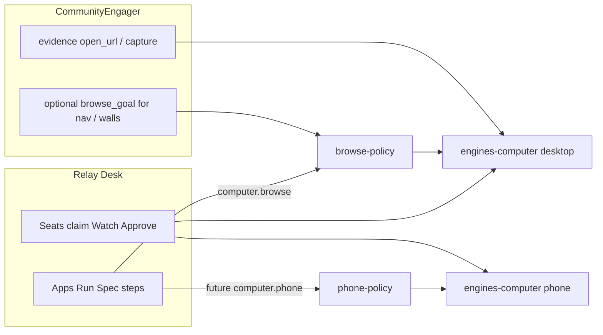

# Wiring browse-policy / phone-policy into CE + Relay Desk

## Verdict (locked)

| Surface | Use | Do not use |
|---------|-----|------------|
| **CommunityEngager** (Reddit legacy) | `@relay/browse-policy` on **desktop** seats when you want LLM micro-steps (nav, walls, “find compose box”) | `@relay/phone-policy` / `kind=phone` for Reddit write or evidence |
| **Relay Desk — Seats console** | Gateway claim/watch (`desk_phone_seats`) for desktop **and** phone HITL | Policy packs inside Desk UI |
| **Relay Desk — Spec / Apps** | `computer.browse` → browse-policy (already); later `computer.phone` → phone-policy | Stretching browse-policy for Android |

**Better CE path than today’s builtins-only computer transport:** keep lease/park + evidence, but drive *agent* navigation/challenge clearance through **browse-policy** (same loop shape as Spec). Phone stays a separate product surface (Telegram dogfood, Desk watch, future Spec phone steps).

## Current state

### CommunityEngager

- **Playwright / browser transport** — primary Reddit write path (session jar, comment).
- **`REDDIT_TRANSPORT=computer`** — desktop `ComputerEngine`:
  - Evidence: `open_url` + `capture_frame` ([`computer-dry-run.ts`](../../apps/community-engager/src/reddit/write/computer-dry-run.ts), preview).
  - Walls: classify frame → park → HITL Approve ([`computer-challenge.ts`](../../apps/community-engager/src/reddit/write/computer-challenge.ts)).
  - **Does not** call `runBrowsePolicyLoop` / `browse_goal` today.
- Explicit non-goal in prior plans: **no phone seats** for CE Reddit ([`phone_policy_split.plan.md`](./phone_policy_split.plan.md)).

### Relay Desk

- **Seats** — HITL approve/abort + Watch; lease defaults to **desktop** (no `kind` on `POST /v1/sessions` yet). Phone Watch already works if an agent leased `kind=phone` and `vnc_url` is reachable.
- **Phone claim/inventory** — planned in [`desk_phone_seats.plan.md`](./desk_phone_seats.plan.md) (HITL only; no policy).
- **Spec** — `use: "computer.browse"` + `withBrowsePolicy` is the supported desktop agent path ([browse-policy README](../../packages/browse-policy/README.md)).

### Policy packs

| Pack | Seat | Entry |
|------|------|--------|
| `@relay/browse-policy` | desktop Firefox | `browse_goal`, `runBrowsePolicyLoop`, Spec `computer.browse` |
| `@relay/phone-policy` | Android | `phone_goal`, `runPhonePolicyLoop`, dogfood Telegram |
| `@relay/computer-seat-policy` | shared | stuck guards, timing, lease/park |

## Target wiring

### A. CE — adopt browse-policy (recommended upgrade)

**Keep:** `ComputerRunSession`, soft-park, evidence PNGs, challenge HITL contract (Telegram/CLI Approve).

**Add (opt-in):** register `browseGoalTask` / call `runBrowsePolicyLoop` for goals like:

- “Open this Reddit thread URL and stop when the post body is visible”
- “Dismiss cookie/login interstitial or stop with need_human”
- Later: “Focus the comment box and type draft” (still gated by existing Approve)

**Do not:** replace notify-only / manual post mode; do not lease `kind=phone` for Reddit.

Suggested seam: beside [`computer-challenge.ts`](../../apps/community-engager/src/reddit/write/computer-challenge.ts) — when `COMPUTER_BROWSE_POLICY=1` (or similar), run a short browse loop with stuck defaults (`maxSameActionStreak=3`, `maxSameScreenStreak=6`) before falling back to classify + HITL.

### B. Desk — two layers (do not merge)

1. **HITL layer** ([`desk_phone_seats.plan.md`](./desk_phone_seats.plan.md))  
   Operator claims desktop or phone, Watch stream, Park/Acquire/Recycle. No LLM policy in Desk.

2. **Agent layer** (Spec / CE / dogfood)  
   App leases seat via engines + policy pack; Desk only **watches** the same `vnc_url` / HITL cards.  
   - Desktop agent → browse-policy  
   - Phone agent → phone-policy  

Desk should document: “Watch works for whichever kind the gateway leased; Open seat must pick kind once phone claim ships.”

### C. Spec — phone later

- Today: `computer.browse` → browse-policy only.  
- Later: `computer.phone` / `phone_goal` once Desk phone HITL + phone-policy dogfood are stable.  
- Do not reintroduce `seatKind: "phone"` on browse APIs.

## Implementation order

1. **This doc** + README pointers (done with this plan).
2. **Desk phone HITL** — finish [`desk_phone_seats`](./desk_phone_seats.plan.md) so operators can claim/watch phones that phone-policy dogfood uses.
3. **CE browse-policy opt-in** — thin env-gated path for computer transport (desktop); tests with mock gateway + scripted decider.
4. **Spec `computer.phone`** — only after (2) and phone-policy stuck/phase dogfood feel trustworthy.

## Non-goals

- CE Reddit on Android / Telegram-as-Reddit-client
- Embedding policy loops inside Desk React
- Replacing Playwright session ensure with browse-policy overnight
- Changing computer-with-agent contracts beyond existing kind/seat_id

## Pointers

- CE: [`apps/community-engager/README.md`](../../apps/community-engager/README.md)  
- Desk: [`apps/relay-desk/GUIDE.md`](../../apps/relay-desk/GUIDE.md) · [`desk_phone_seats.plan.md`](./desk_phone_seats.plan.md)  
- Packs: [browse-policy](../../packages/browse-policy/README.md) · [phone-policy](../../packages/phone-policy/README.md) · [computer-seat-policy](../../packages/computer-seat-policy/README.md)  
- Prior: [phone_policy_split](./phone_policy_split.plan.md) · [computer_phone_seat_bind](./computer_phone_seat_bind.plan.md)
