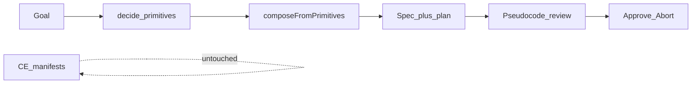

# Spec primitive plan (goal-specific procedure)

## Do we need a plan?

**Yes — a short one.** The shell compose loop exists; the missing product piece is making Specs **reviewable as procedure**, not as a chip bag. That needs a typed shape, compose emission, UI, and docs — enough for a focused plan, not a rewrite of CommunityEngager.

## North star

```text
Free-form goal
  → decide catalog primitives
  → compose draft Spec
       + ordered primitive plan (goal-specific pseudocode)
  → human Approve / Abort (plan is the primary read)
```

| Is | Is not |
|----|--------|
| Spec-owned **ordered steps**, each a catalog primitive + goal-specific intent line | A full CE `AgenticAppManifest` / stage graph |
| The surface you read before freeze | Inventing unbound stages outside the catalog |
| Parity *target* for engage-like goals (sense → … → wait_human → write) | Replacing `apps/community-engager` manifests |

**Hard invariant:** CommunityEngager manifest runtime stays. This plan is additive.



## Shape (v0)

```ts
// illustrative
type SpecPlanStep = {
  id: string;                 // stable step id
  primitive: SpecPrimitiveId; // catalog only
  intent: string;             // goal-specific one-liner
  sideEffect?: SideEffectClass;
};

type SpecPrimitivePlan = {
  version: 1;
  steps: SpecPlanStep[];
};
```

Persist on Spec (preferred) or alongside bundle metadata. Compose fills `intent` lines from the goal + primitive role (template / light decide — not free-form stage invention).

## Phases

1. **`plan-shape`** — protocol types + docs (Spec plan ≠ manifest)
2. **`plan-from-compose`** — emit plan in `composeFromPrimitives` / shell create path
3. **`plan-review-ui`** — Spec review primary = pseudocode listing
4. **`plan-parity-docs`** — engage-like acceptance for plan coverage; CE coexistence

## Out of scope

- Rewriting CE stages onto this plan
- LLM inventing non-catalog steps
- Auto-running the plan under a new universal executor (follow-on: derive thin runner *from* plan)

## Done when

- Creating a Spec in the shell yields a **goal-specific ordered plan**
- Review reads like short pseudocode procedure
- CE `run-dev` / demos / deploy unchanged
