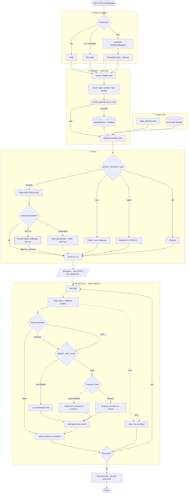

# CommunityEngager

First Relay dogfood app: discover fashion/styling subreddits (HITL promote onto allowlist), scout postable subs, draft a reply, **pause for human Approve / Edit / Abort**, then optionally post, then write outcomes to VoltMem.

**Hard rule:** nothing posts without human Approve (`REDDIT_DRY_RUN=true` by default).  
**Allowlist rule:** discovery only proposes; a sub is not postable until a human promotes it.

Related plans:

- [HITL + CommunityEngager + VoltMem](../../.cursor/plans/relay_hitl_community_voltmem.plan.md) — Phase 6 discovery + nested fanout
- [Reddit browser / scrape transport](../../.cursor/plans/relay_reddit_browser.plan.md) — browser scout, ensure_session, interstitial HITL
- [Authority + metrics](../../.cursor/plans/community_engager_authority_metrics.plan.md) — warmup, promo-ratio, post-watch, north-star metrics
- [ThinkPad deploy](../../.cursor/plans/relay_thinkpad_deploy.plan.md) · runbook [`deploy/README.md`](../../deploy/README.md) · [`deploy/SMOKE.md`](../../deploy/SMOKE.md)

## Workflow

Ensure session → **discover** (optional / env) → scout allowlist → queue one job per opportunity → draft → you decide → execute only if approved → memory learns.



### Source layout

| Path | Role |
|------|------|
| `src/stages/{discover,scout,post-watch,draft,execute,learn}/` | Stage-owned domain modules |
| `src/policy/` | Cross-stage gates (cadence, promo, warmup, playbook, allowlist) |
| `src/reddit/` | `config` + `client`; procedures under `session/`, `interstitial/`, `scout/`, `write/` |
| `src/admin/` | Admin-shell collections |
| `src/host/` | Process entrypoints (`run-dev`, `run-scheduler`, `run-ops`, `admin`, …) |
| `src/ops/` | Ops intents: parse + controller (CLI stdin / Telegram idle → schedules + one-offs) |
| `src/decide/` | Decide engines + HITL feedback mapping (`login`, `composer`, `interstitial`, `feedback-map`) |
| `src/metrics/` | Run recording (`job-queue`, `run-evidence`, `run-log`, `authority-metrics`) |
| Root (`controller`, `manifest`, `index`, …) | App wiring |

### Stages (short)

| Stage | What happens |
|-------|----------------|
| `ensure_session` | Cookie jar / HITL login before live browser work (skipped when dry-run unless `REDDIT_ENSURE_SESSION=true`) |
| `discover` | Read-only subreddit research → `choice` HITL to promote onto allowlist (or skip) |
| `scout` | Find actionable threads on **postable** allowlist (browser → json → oauth → fixtures); anti-bot wall → headed browser + Telegram/CLI Approve (never auto-solved) |
| `draft` | Write a reply with Gemini when `GEMINI_API_KEY` is set; otherwise a stub. May pull VoltMem context |
| `await_approval` | You Approve / Edit / Abort (Telegram or CLI) |
| `execute` | Dry-run log, or live browser/oauth post (also enrolls post-watch) |
| `learn` | Persist HITL outcome to VoltMem (`community_outcome`) + allowlist ranking |
| `post_watch` | **Separate entrypoint** — poll enrolled live posts (24–72h); fan out follow-up jobs |

**Engage** (`pnpm start`): default `stages` — `ensure_session` → `discover` → `scout` → `jobs`.  
**Post-watch** (`pnpm watch:posts` or `--entrypoint post_watch`): protocol `entrypoints.post_watch` — `post_watch` → `jobs` only (no scout).  
**Ops daemon** (`pnpm scheduler`): long-lived `@relay/scheduler` host for `cadence` + `post_watch`, plus ops intents on CLI stdin (or Telegram when idle). Flags: `--once`, `--schedule <id>`, `--run-on-start`. Escape hatches: `pnpm start` / `pnpm watch:posts`.  
**One-shot ops** (`pnpm ops -- "<intent>"`): same vocabulary, short-lived process (does not share in-memory pause state with a running daemon).

The `jobs` stage **fans out** into `CommunityJobManifest` — one isolated `AgentRuntime` per opportunity. Budget engage with `COMMUNITY_MAX_JOBS` (default 3); post-watch fanout is capped by `min(jobs.maxJobs, postWatch.maxPerRun)`. Discover defaults to `COMMUNITY_DISCOVER=auto`; use `force` / `--force-discover` or `off`.

### Ops intents

Exact phrases (also from `help` / unknown input). HITL cards always win over ops when a present is in flight.

| Intent | Effect |
|--------|--------|
| `engage` · `engage community` · `scout reddit` | One-off engage run |
| `watch posts` · `post watch` | One-off post_watch run |
| `start cadence` · `stop cadence` | Resume / pause schedule `cadence` |
| `start post watch` · `stop post watch` | Resume / pause schedule `post_watch` |
| `start schedules` · `stop schedules` | Arm all enabled / stop host |
| `run cadence now` · `run post watch now` | `trigger` that schedule (rejects if paused) |
| `status` · `schedules` | Armed list, paused/active, next run |
| `help` | Print this vocabulary |

```bash
# Interactive daemon (CLI)
FEEDBACK_ADAPTER=cli pnpm scheduler
# then type: status · stop cadence · help · quit

# Telegram: same daemon; send phrases when no HITL card is pending
FEEDBACK_ADAPTER=telegram pnpm scheduler

# One-shot
pnpm ops -- status
pnpm ops -- "stop cadence"
```

Long-running intents (`engage`, `run … now`, `start schedules`) send an immediate **processing** ack on Telegram/CLI before the final reply or HITL card.

**One active app run:** one-offs and schedule ticks share a mutex (same Telegram adapter). While a run is in progress, `engage` / `run … now` / `start|stop schedules` are rejected with a busy reply; `status` and per-schedule pause/resume still work. Cron ticks that collide are skipped and logged (not queued).

Pause state is process-local on the daemon; evidence under `{REDDIT_DATA_DIR}/schedules/*.evidence.json` records last pause for admin. Canonical list: [`src/ops/command.ts`](./src/ops/command.ts) (`OPS_HELP`).

### Rules that matter

| Rule | Meaning |
|------|--------|
| Nothing posts without Approve | Abort skips execute |
| `REDDIT_DRY_RUN=true` | Safe default — logs only |
| Browser first | Playwright + cookies; OAuth optional backup |
| Allowlist + score ≥5/8 | problemFit, help, rules, freshness, value, competition, icpFit, plugNaturalness |
| CAPTCHAs are never auto-solved | Detect, then escalate to a human or degrade quietly |
| Discovery proposes, humans promote | A newly researched sub is not postable until approved |
| Warmup forces intensity 0 | Until account age / karma / help-comment thresholds (`warmup` in config) |
| Promo-ratio ledger (~9:1) | Rolling window caps intensity ≥1; `promo.onExceed` = `block` or `warn` |
| Post-watch (24–72h) | Live execute enrolls; separate `watch:posts` entrypoint polls + follow-up jobs |
| Soft-CTA drafts | Help first; intensity 0 = no product; 1 = name mention only; 2 = disclose + one LP link (`product.lpBaseUrl` / `GOSTYLENS_LP_BASE_URL`) |
| Sub playbooks | Per-allowlist `playbook`: rules summary, `plugStyle`, `megathreadPolicy`, `maxPlugsPerWeek` — clamps draft intensity and megathread scout |
| Daily cadence | Caps live help/promo posts per local day; `pnpm scheduler` arms `cadence` (engage) + `post_watch` via `@relay/scheduler` |
| Visibility check | After live execute, logged-out permalink fetch; flags removal / missing (shadowban-adjacent) |
| Job UTM attribution | LP links: `utm_medium=community-engager`, `utm_campaign=community_<sub>`, `utm_content=<jobId>`; attribution ledger |

Warmup (`warmup.mode=auto`) keeps drafts help-only until local live intensity-0 posts and (when known) Reddit account age/karma clear the thresholds. State: `{REDDIT_DATA_DIR}/warmup/state.json`.

Promo ratio (`promo.maxRatio` default `0.1`, `windowDays` `30`) tracks live posts in `{REDDIT_DATA_DIR}/promo/ledger.json`. When a soft mention would push the window over the max, **`block`** forces intensity 0 (default) or **`warn`** surfaces the ratio in HITL without clamping. See [authority + metrics plan](../../.cursor/plans/community_engager_authority_metrics.plan.md).

Post-watch (`postWatch.enabled`, default on) enrolls each live-posted comment. The `post_watch` entrypoint (CLI or `pnpm scheduler` / ops) polls after `minAgeHours` (24) and before `maxAgeHours` (72) via public permalink JSON. Replies become intensity-0 follow-up opportunities; removals are marked. Queue: `{REDDIT_DATA_DIR}/post-watch/queue.json`. Manifest schedule: `every_ms` 6h via the ops daemon.

Daily cadence (`cadence.enabled`, default on) counts today's ledger posts and caps opportunities / execute by `maxHelpPerDay` (default 5) and `maxPromoPerDay` (default 1). Per-sub weekly soft mentions stay in playbook `maxPlugsPerWeek`. Scheduled engage: manifest schedule `cadence` → default entrypoint, cron `cadence.scheduleCron` (default `0 9,13,18 * * *`), `maxJobsPerRun` (default 2) per fire — same `@relay/scheduler` host as post_watch (`pnpm scheduler`).

Visibility (`visibility.enabled`, default on) waits `delayMs` (default 3000) then fetches the posted permalink as a logged-out client. Results: `visible` / `removed` / `missing` / `error`; persisted under `{REDDIT_DATA_DIR}/visibility/`. Does not fail the execute stage — warns loudly for ops follow-up. Longer-horizon reply/removal polling stays in post-watch.

UTM on intensity-2 / execute LP links (see `utm.ts`):

| Param | Value | Why |
|-------|--------|-----|
| `utm_source` | `reddit` | Platform |
| `utm_medium` | `community-engager` | This app (stable product filter) |
| `utm_campaign` | `community_<subreddit>` | Community + sub (matches scout draft label) |
| `utm_content` | sanitized `jobId` | Per-post join key |
| `utm_term` | subreddit | Optional bare-sub slice |

Join records: `{REDDIT_DATA_DIR}/attribution/<jobId>.json`.

## Config

| Layer | What goes there |
|-------|-----------------|
| [`config/default.json`](./config/default.json) | Policy defaults (warmup, promo, postWatch, cadence, visibility, discover, scout, jobs, LP URL) |
| `config/local.json` | Optional machine overrides (gitignored; copy [`local.example.json`](./config/local.example.json)) |
| [`.env`](./.env) | Secrets, paths, dry-run / browser host toggles |
| Env vars | Still override any policy key when set (CI / one-offs) |

Load order: built-in defaults → `default.json` → `local.json` → env. Point at another directory with `COMMUNITY_CONFIG_DIR`. Resolved runtime shape is nested (`cfg.warmup.mode`, `cfg.scout.delayMs`, `cfg.reddit.dryRun`, …) via `getCommunityConfig()`.

## Quick start

```bash
# From repo root (Node 22+)
pnpm --filter @relay/engines-browser exec playwright install chromium
cp apps/community-engager/.env.example apps/community-engager/.env
# Optional policy tweaks:
# cp apps/community-engager/config/local.example.json apps/community-engager/config/local.json
# Set Telegram (or FEEDBACK_ADAPTER=cli), REDDIT_USERNAME/PASSWORD for browser path

pnpm --filter @relay/apps-community-engager build
REDDIT_LOGIN_HEADED=true pnpm --filter @relay/apps-community-engager login:reddit   # once
pnpm --filter @relay/apps-community-engager start
```

See [`.env.example`](./.env.example) for secrets/host flags and [`config/default.json`](./config/default.json) for policy knobs.

## Browse / edit local data

Loopback admin (`@relay/admin-shell`) with app-owned adapters:

| Collection | Source env | Capabilities |
|------------|------------|--------------|
| Actions | `ACTION_STORE_PATH` | edit draftText, status, delete |
| Allowlist | `ALLOWLIST_PATH` (default `{REDDIT_DATA_DIR}/allowlist/subreddits.json`) | edit, promote, reject |
| Jobs | `JOBS_DIR` | inspect, delete |
| Runs | `COMMUNITY_RUNS_DIR` (may be outside `.data/`) | inspect, delete, debug charts (timeline, duration×outcome, scout funnel, authority slice) |
| Authority | `{REDDIT_DATA_DIR}` | north-star score card — promoRatio, visibilityRate, replyRate, attributed activations |
| Schedules | `{REDDIT_DATA_DIR}` | entrypoints + `schedules[]`; last/next from `schedules/*.evidence.json` when `pnpm scheduler` has run |

```bash
pnpm --filter @relay/admin-shell build
pnpm --filter @relay/action-store build
pnpm --filter @relay/scheduler build
pnpm --filter @relay/apps-community-engager build
pnpm --filter @relay/apps-community-engager admin:store
# → http://127.0.0.1:8787
```


Paths are set in [`.env`](./.env) (see [`.env.example`](./.env.example)). Relative values resolve against the `.env` directory.

Action CLI:

```bash
pnpm --filter @relay/apps-community-engager run actions list --status pending_approval
pnpm --filter @relay/apps-community-engager run actions get <id>
```

Authority score (`visibility × replyRate × (1 − promoRatio)`, × activations when imported) is computed from `{REDDIT_DATA_DIR}` ledgers. Paste product counts into `{REDDIT_DATA_DIR}/attribution/activations.json` as `{ "count": N, "updatedAt": "…" }` (or Authority collection action `set_activations`) when GoStylens reports Reddit-attributed signups.

VoltMem outcome tags (beyond approve/abort): `got_reply` / `removed` / `dm_interest` from post-watch + visibility; `signup_attributed` via `writeSignupAttributedForDelta` after activation bumps. Draft remember queries include these tokens; `tag=removed` forces help-first drafting.

Do not hand-edit JSON while the agent is writing.
